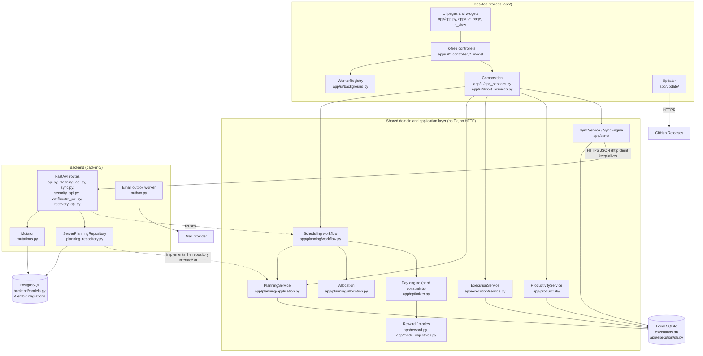
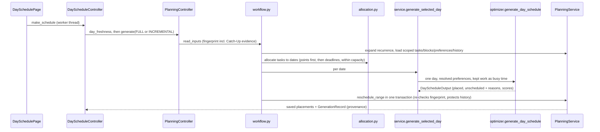
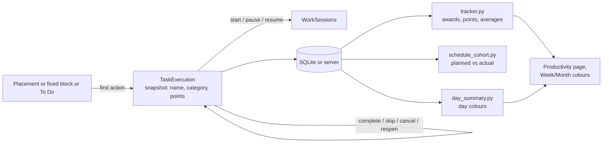
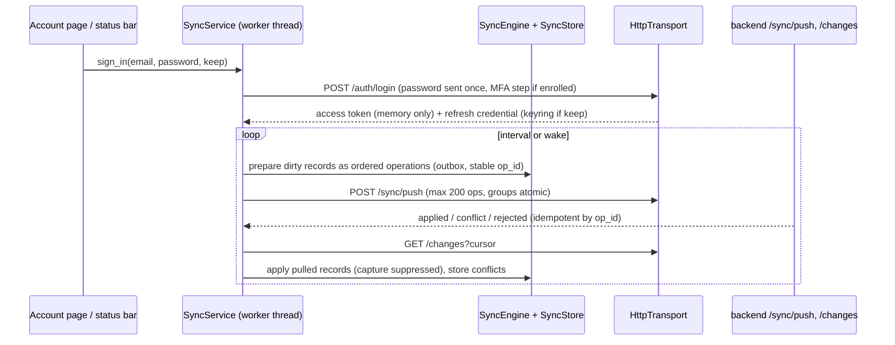

# Architecture

System-level view of Schedule Maxing. For file-level navigation and change impact see
[CODEBASE_MAP.md](CODEBASE_MAP.md); for what works today see [CURRENT_STATE.md](CURRENT_STATE.md); for the
reasons behind the structure see [DECISIONS.md](DECISIONS.md). Detailed contracts live in `docs/` and are
linked where relevant rather than repeated.

Verified against commit `c2b19c0` (app version 1.3.0, branch `engine-remake`) on 2026-10-24.

## 1. What the system is

A personal scheduling and productivity application. Users enter **flexible tasks**, **fixed blocks** and
**To Dos**; a deterministic engine places flexible work into a day around hard constraints; the user then
records what actually happened (complete, skip, timed sessions) and earns **points**, which the
Productivity page analyses. The README's author note says the product's emphasis moved from schedule
generation toward recording and productivity tracking; the engine remains.

Three deployable parts, all Python 3.10, in one repository:

| Part | Runs where | Entry point | Storage |
|---|---|---|---|
| Desktop app (CustomTkinter) | User's Windows PC (installer) or from source on any OS with Tk | `app/desktop.py` (production), `app/app.py` (development) | Local SQLite (default) or, dev-only, direct PostgreSQL |
| Backend API (FastAPI) | Render web service (manual or CI deployment) | `uvicorn --factory backend.app:create_app` (`backend/main.py` also exposes `app`) | PostgreSQL (SQLAlchemy 2 + Alembic) |
| Optional local web profile | Loopback on the user's machine | `python -m app.web` | The same local SQLite as the desktop (never at the same time) |

Also present: a CLI (`python -m app.main`), productivity CLIs (`app/productivity/report_cli.py`), operator tools in `backend/` (`migrate`, `maintenance`, `inspect_db`,
`smoke_check`, `email_diagnostic`) and offline benchmarks (`benchmarks/`).

Not in this repository: an Android client (mentioned in the README's author note only) and the browser web
UI (`docs/web-api.md` is the API contract it would be built against; `app/web` can serve a `--static-dir`).

## 2. Technologies

| Concern | Choice | Where declared |
|---|---|---|
| Language | Python 3.10 (CI, release build and `.venv`) | `.github/workflows/*.yml`, `packaging/windows/build_windows.ps1` |
| Desktop UI | CustomTkinter on Tk, plus `ttk.Treeview` | `requirements-desktop.txt` |
| Domain models | Pydantic v2 | `app/planning/models.py`, `app/execution/models.py` |
| Local storage | `sqlite3` (stdlib), hand-written ordered migrations | `app/execution/db.py` |
| Credentials on device | `keyring` (OS credential store) | `app/sync/credentials.py` |
| Client HTTP | Standard library only: `http.client` with one keep-alive connection (sync), `urllib` (updater) | `app/sync/transport.py`, `app/update/transport.py` |
| Server | FastAPI, Starlette, Uvicorn | `requirements-backend.txt` |
| Server storage | SQLAlchemy 2, Alembic, psycopg 3; SQLite only for the ordinary test suite | `requirements-database.txt`, `backend/database.py` |
| Server auth | argon2-cffi (Argon2id), PyJWT (HS256 access tokens), pyotp (TOTP), cryptography (Fernet for MFA secrets) | `backend/passwords.py`, `backend/security.py`, `backend/mfa.py` |
| Email | SMTP, Resend, Brevo or Mailjet through a durable outbox | `backend/mail.py`, `backend/outbox.py` |
| Packaging | PyInstaller (folder build) + Inno Setup 6 | `packaging/windows/` |
| CI/CD | GitHub Actions; Render for the backend; GitHub Releases for the desktop | `.github/workflows/` |
| Lint / tests | Ruff, pytest with automatically assigned tiers | `pyproject.toml`, `tests/test_tiers.py` |

Dependency sets are deliberately split (`requirements-desktop.txt`, `-direct`, `-database`, `-backend`,
`-build`, `requirements.txt` for development); `requirements.lock` pins them for the security scan.

## 3. Component architecture

Key boundary: **one engine, one set of domain services, optional HTTP adapters.** The desktop calls
controllers and services in-process; it never calls an HTTP route of its own and runs with no web
package installed (`docs/desktop-web-boundaries.md`, enforced by `tests/test_desktop_isolation.py` and the
`desktop-only` CI job). The backend imports the shared domain layer (`app.planning`, `app.execution.lifecycle`)
so the same rules run on both sides.

### 3.1 Layers

| Layer | Responsibility | Modules |
|---|---|---|
| Models | Canonical planning models (calendar dates, UUIDs, owners, versions; tasks have points, no priority or dependencies); execution models | `app/planning/models.py`, `app/execution/models.py` |
| Hard constraints | Whether a placement is allowed (window, fixed blocks, overlaps, durations, fixed-block write rules, DST/overnight refusal) | `app/optimizer.py` (checked before any scoring), `app/planning/fixed_block_rules.py`, `app/planning/time.py` |
| Reward | How good a valid placement is (typed `ScoringTask`: category weight, preferred window, neighbour relation, fragmentation, ADHD short-gap bonus); settings from `config/task_preference.yaml` and preference layers | `app/reward.py`, `app/planning/preferences.py` |
| Engine | The canonical minute-precise day engine; mode objectives | `app/optimizer.py`, `app/mode_objectives.py`, `app/planning/catch_up.py` |
| Application | Persisted planning (CRUD, ranges, rescheduling, resets, CSV), the scheduling workflow, recurrence, freshness | `app/planning/application.py`, `workflow.py`, `service.py`, `allocation.py`, `series.py`, `provenance.py`, `csv_*.py` |
| Execution | Lifecycle rules (shared with the server), execution persistence, fixed-block and direct completions | `app/execution/` |
| Analytics | Statistics, tracker (awards, points), schedule cohort, day summaries, median predictor | `app/productivity/` |
| Budget | Balance, income/expense entries with recurrence, occurrence edits, range expansion and totals in integer minor units, history statistics and the 90-day forecast (`stats.py`), income ideas and the wishlist; never read by constraints, reward or engines (a project link is a reference only) | `app/budget/` (storage: `repository.py` local, `app/persistence/budget.py` direct) |
| Sync client | Dirty tracking, outbox, shadows, conflicts, push/pull, credentials | `app/sync/` |
| UI | Pages/views draw; controllers/models hold UI logic and call services | `app/ui/`, `app/app.py` |
| Runtime | Source vs packaged paths, data/log/backup/update folders, logging, self-test | `app/runtime.py`, `config/settings.py`, `app/logging_setup.py`, `app/selftest.py` |
| Server | HTTP, auth, accounts, sync endpoint, normalized storage, email, rate limits | `backend/` |

## 4. Desktop UI architecture

- **Shell.** `ScheduleOptimizerApp` (`app/app.py`, a `ctk.CTk`) builds an `AppShell` (`app/ui/shell.py`)
  with a collapsible sidebar and a page host; navigation state is the Tk-free `ShellState`
  (`app/ui/shell_state.py`). Pages: Day, Week, Month (`CalendarPage`), Project Schedule (`ProjectsPage`),
  Productivity, Budgeting (`BudgetingPage`: General / Stats / Future), Settings and About (a
  `PlaceholderPage`). Settings is one sidebar item whose top bar (`GroupBar`, `shell_state.PAGE_GROUPS`)
  switches between the Settings, Account and How to Use (`GuidePage`) pages, which keep their own keys. The Day page also shows the date's budget transactions and
  income/expense totals (`app/ui/day_money.py`), read through the same `BudgetController` as Budgeting.
- **View/controller split.** `*_page.py`/`*_view.py` create widgets; `*_controller.py`/`*_model.py` are
  Tk-free, unit-tested, and return `ControllerResult` (`.ok`, `.value`, `.error`) instead of raising.
- **Composition.** `open_app_services` (`app/ui/app_services.py`) takes the database's single-process lock,
  opens the one SQLite connection (migrating and backing up first) and builds Planning, Execution and
  Productivity controllers plus a `SyncService` for one **workspace** (owner scope);
  `budget_controller()` builds the Budgeting/Day `BudgetController` bound to that workspace when its pages are
  built. `DirectAppServices`
  (`app/ui/direct_services.py`) offers the same surface over PostgreSQL for the dev-only direct mode.
- **Threading.** All storage and computation runs off the Tk thread through `WorkerRegistry`
  (`app/ui/background.py`): at most 4 worker threads, a serial `WRITE_LANE` so mutations never interleave,
  results handed back by a main-thread `after` poll, and results of a previous workspace or destroyed page
  dropped. Workers never touch Tk. `SyncService` runs its own daemon thread with interval and exponential
  backoff. `app/ui/tk_lifecycle.py` moves cyclic garbage collection onto the Tk thread while windows live.
- **Start-up sequence.** `app.app` imports none of the non-Day page modules. The constructor opens
  storage, builds the shell and the Day page only; every other page (Week, Month, Projects, Productivity,
  Budgeting, Settings, Account, How to Use, About) is a `DeferredPage` (`app/ui/pages.py`) built, with its
  module, the first time it is shown. The Day page reads its date in a worker; CustomTkinter shows the window
  when `mainloop()` starts. The OS credential store is found on first use or by a background prefetch 1.5 s
  later (`LazyVault`; no prefetch when no backend is configured), and the first background sync waits 3 s (ADR-041).
- **Activity and periodic work.** `app/ui/activity.py` (Tk-free) turns the root's focus/map events into
  focused / unfocused / minimized; `ACTIVITY_POLICIES` sets the status-bar poll (4 s / 15 s / paused), the GC
  timer's interval and `SyncService.set_activity` (sync interval 60 s / 300 s, no pending looks while
  minimized; ADR-041). CustomTkinter's tracker loops are slowed once at start-up
  (`tk_lifecycle.tune_customtkinter_loops`).
- **Redraw avoidance.** `AppServices.data_version()` (the connection's change count plus the workspace epoch)
  lets Day, Week/Month, Projects and Productivity skip re-reading and re-rendering on show when nothing was
  written since their last read (`app/ui/page_freshness.py`). The shown page is placed in the shell's page
  area at a fixed size that follows the window only after it kept its size for 120 ms (`PAGE_SETTLE_MS`), so a
  drag-resize lays the page out once. Week is pre-built in idle time, one part per Tk callback
  (`DeferredPage.prebuild_step`, `ScheduleOptimizerApp._prebuild`).
- **Native-window budget.** Every Tk widget is a Win32 child window and moving the window costs dwm.exe work
  per child window, hidden ones included; long lists and static text use the one-window widgets of
  `app/ui/light_widgets.py`, and hidden pages other than Day and the page left last are detached into a
  withdrawn window of their own (`AppShell._hide`, ADR-043). With the opt-in light caching, every hidden page
  but Day is destroyed instead (`DeferredPage.release`) and built again on its next show (ADR-045).
- **Engine process.** A schedule generation runs in a worker thread, but its day-engine calls run in one
  separate spawned process (`app/planning/engine_process.py`, ADR-044), so their CPU never holds the GIL the
  Tk thread needs; everything that touches the database stays in the thread. `EngineProcess.shutdown` waits
  for the process (and a call already running) to end, so closing the storage leaves nothing running.
- **Error handling.** Startup failures show a "Database Unavailable" panel rather than a scheduler that
  cannot save. `app/desktop.py` installs log files and exception hooks (`app/logging_setup.py`, with secret
  scrubbing) because the packaged app has no console.

## 5. Persistence

### 5.1 Local SQLite (default)

One file, `executions.db`, under the per-user data folder (`%LOCALAPPDATA%\ScheduleMaxing` on Windows;
`SCHEDULE_MAXING_DATA_DIR` overrides). `app/execution/db.py` owns the connection, the transaction/lock
helpers and 19 ordered schema migrations (`MIGRATIONS`, `LATEST_SCHEMA_VERSION`). Before migrating, the
file is copied by `app/execution/backup.py`; a newer schema than the code knows is refused
(`NewerSchemaError`). A pre-Milestone-2 `data/` folder in a source checkout is adopted once.

Tables: planning (`projects`, `task_types`, `tasks` + `task_tags`/`task_preferred_dates`/
`task_recurrence_weekdays`, `fixed_blocks`, `scheduled_tasks` (placements),
`preference_overrides`, `schedule_generations`), execution (`executions`, `work_sessions`), sync
(`sync_accounts`, `sync_dirty`, `sync_shadows`, `sync_outbox`, `sync_conflicts`, `sync_control`,
`execution_wire_ids`), budget (`budget_balances`, `budget_entries`, `budget_overrides`; v17;
`budget_ideas`, `budget_wishes`; v18) and
`local_settings`. Every synchronizable record carries an owner (`user_id`,
NULL = guest workspace), a `version` and a deletion marker (tombstone).

Repositories: `app/planning/repository.py` (`PlanningRepository`), `app/execution/repository.py`
(`ExecutionRepository`) and `app/budget/repository.py` (`BudgetRepository`) are the only SQL writers;
services above them hold the rules. Recurring budget entries are expanded per query; only the entry and
its per-occurrence edits are stored. One process per
database file is enforced by `app/execution/instance_lock.py`.

### 5.2 Server PostgreSQL

`backend/models.py` (SQLAlchemy ORM) is normalized: live tables, typed immutable **revision** tables
(`record_revisions` + `*_revisions`) referenced by recorded sync outcomes, a commit-ordered `change_log`,
`sync_operations` for idempotency, and account/security tables (sessions, refresh credentials, tokens,
MFA, rate-limit buckets, email outbox). 20 Alembic revisions in `backend/migrations/versions/`;
`backend/migrate.py` applies them; a test compares the migrated schema with the ORM.

### 5.3 Direct PostgreSQL mode (development only)

`python -m app.app --storage postgres --env-file .env` composes `app/persistence/` over the backend's own
schema, account rules and mutation path (budget records included, through
`app/persistence/budget.py`). No local replica, no sync. The production entry point
`app/desktop.py` ignores it because a distributed client must never hold database credentials.

## 6. Scheduling engine

- **One engine.** `generate_day_schedule` is the canonical engine: exact event-candidate greedy search at
  minute resolution over UUID-identified canonical models (Greedy Optimizer v1 was removed, ADR-047).
- **Five modes are objectives, not optimizers** (`docs/scheduling-modes.md`): Normal (`precise_greedy`),
  ADHD (`adhd_friendly`, quarter-hour starts for long tasks), Early Finish and Night Owl (baseline greedy then
  bounded repacking, `_refine_time_objective`), Catch-Up (greedy with per-task history bonuses from
  `app/planning/catch_up.py`).
- **Hard constraints vs reward.** Constraints decide validity; reward (`calculate_task_score`) ranks valid
  candidates. Hard constraints are never converted to penalties.
- **Allocation** (`app/planning/allocation.py`) only chooses dates for a week/month; it never sets minutes.
  It places tasks points first (points desc, deadline, duration desc, id; ADR-049), so points are a
  fingerprint input; the day engine never reads them.
- **Freshness/provenance** (`app/planning/provenance.py`): each saved day stores an inputs fingerprint and
  placements digest, so a schedule is reported stale after any input change and a stale save is refused.
- **Unsupported windows**: overnight windows and days containing a DST transition raise explicit errors
  (`UnsupportedSchedulingWindowError`).

## 7. Execution tracking and analytics

- Transition rules are pure (`app/execution/lifecycle.py`) and shared by `ExecutionService`, the backend
  (`backend/executions.py`, `outcomes.py`) and the direct adapters.
- Executions snapshot task attributes (including points) at creation, so history survives task edits.
- `ProductivityService` (`app/productivity/reporting.py`) is the analytics boundary; the tracker
  (`tracker.py`) feeds the Productivity page's General / Specific / Project sections. Analytics compute from
  authoritative records every time; there is no stored counter.
- There is no machine learning: duration prediction is the median-based predictor only (ADR-046).

## 8. Accounts, authentication and synchronization

- **Offline first and inert by default.** Sync needs a configured backend URL (default
  `config.settings.DEFAULT_BACKEND_URL`; `SCHEDULE_MAXING_BACKEND_URL=off` disables) and a signed-in account.
- **Change capture** is by SQLite triggers into `sync_dirty` in the same transaction as the write
  (`docs/sync-protocol.md`). Versions sent are the last acknowledged server version (shadows), not local
  counters.
- **Ownership.** Records belong to a workspace; signing in does not claim guest records until the explicit
  association step; account creation adopts the guest workspace.
- **Optional record types.** Task types and budget records are synchronized only when the server lists the
  feature (`task_types`, `budget`); otherwise they stay queued locally. `GET /changes` returns them only with
  `include_task_types` / `include_budget`, so older clients never receive unknown types. A client that first
  sees `budget` replays the change feed once from the start to pick up budget changes it skipped before.
- **Server side.** Every write (REST CRUD, planning API, sync push) goes through one `Mutator`
  (`backend/mutations.py`): user scoping, preconditions, versions, change log. Access is derived only from a
  verified bearer token or a browser session cookie with CSRF (`backend/api.py: current_user_id`).
- **Account security** (`docs/account-security.md`): Argon2id with bounded concurrent hashing, rotating
  refresh credentials with reuse detection, session listing/revocation, optional TOTP MFA with recovery
  codes, email verification, password recovery and email change via the durable outbox, database-backed
  sliding-window rate limits, request size limits, trusted hosts/CORS, log redaction.

## 9. Configuration, deployment and environments

- **Desktop configuration** (`config/settings.py`): `SCHEDULE_MAXING_DATA_DIR`, `SCHEDULE_MAXING_TIMEZONE`,
  `SCHEDULE_MAXING_BACKEND_URL`, `SCHEDULE_MAXING_UPDATE_REPOSITORY`, `SCHEDULE_MAXING_UPDATE_CHECK`,
  `SCHEDULE_MAXING_STORAGE`, `SCHEDULE_MAXING_ENV_FILE`, `SCHEDULE_MAXING_GENERATION_PROCESS` (`off`: the day
  engine runs in the worker thread instead of its own process, ADR-044). Reward defaults come from
  `config/task_preference.yaml` read through `app.runtime.resource_path`. Appearance and task-form defaults
  are per-device JSON files (`app/ui/ui_settings.py`, `app/ui/task_defaults.py`).
- **Backend configuration** comes only from environment variables (`backend/settings.py`, never a `.env`
  file); `.env.example` lists placeholders. Names are catalogued in [CODEBASE_MAP.md](CODEBASE_MAP.md#backend-configuration-names).
- **Desktop delivery**: tag `vX.Y.Z` equal to `app/version.py` → `release.yml` builds with
  `packaging/windows/build_windows.ps1` on Windows (PyInstaller folder build, bundle check, packaged
  self-test, Inno Setup installer, installer test, SHA256SUMS) → GitHub Release → in-app updater
  (`app/update/`) downloads and verifies the checksum, then runs the installer.
- **Backend delivery**: `deploy-backend.yml` deploys a `main` commit whose pull request passed CI to Render
  (gated by `BACKEND_DEPLOY_ENABLED`), then checks `/health` and `/ready`. Migrations run as Render's
  pre-deploy command (`python -m backend.migrate upgrade`).
- **CI** (`ci.yml`, on pull requests and manual runs): `test` (full suite under Xvfb, compileall, Ruff),
  `security-scan` (pip-audit on `requirements.lock`, detect-secrets against `secret-scan-baseline.json`),
  `desktop-only`, `direct-desktop` and `postgres` (PostgreSQL 17 service containers).

## 10. Architectural constraints and limitations

- The desktop must import and run with only `requirements-desktop.txt`; server packages are imported lazily
  and only by direct/web modules.
- Only `app/runtime.py` decides source vs packaged; bundled resources are read-only; writes go under
  `runtime.data_dir()`.
- One process per local database (desktop and local web profile cannot share it).
- One SQLite connection per desktop session behind a lock: concurrency is serialized by design.
- Scheduling is greedy/heuristic with no global-optimum guarantee; no overnight or DST-day windows.
- The version is written once (`app/version.py`); the release tag must match it.
- The direct PostgreSQL mode is a development tool, never part of a distributed build.
- Several large modules concentrate responsibility (`app/planning/application.py`, `app/optimizer.py`,
  `app/execution/db.py`, `backend/models.py`); see [ROADMAP.md](ROADMAP.md) for the maintainability item.
