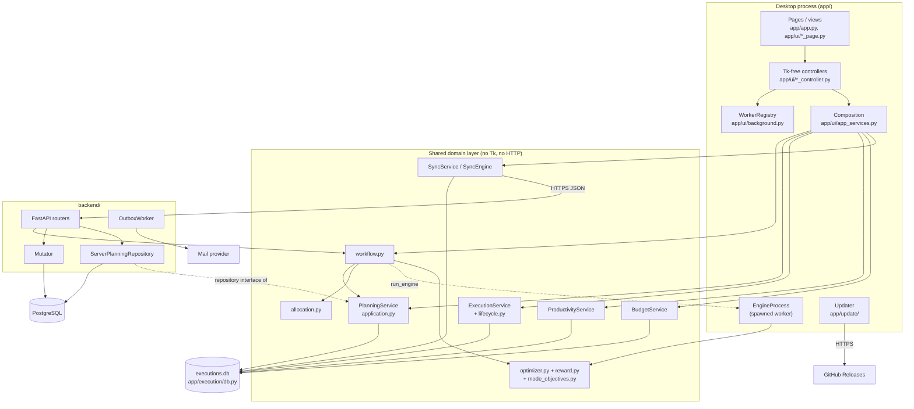
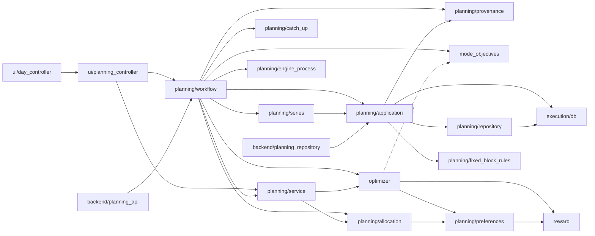
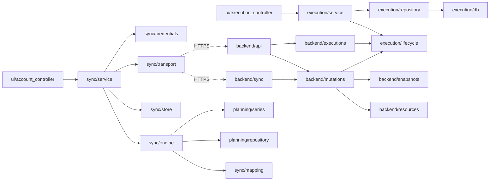
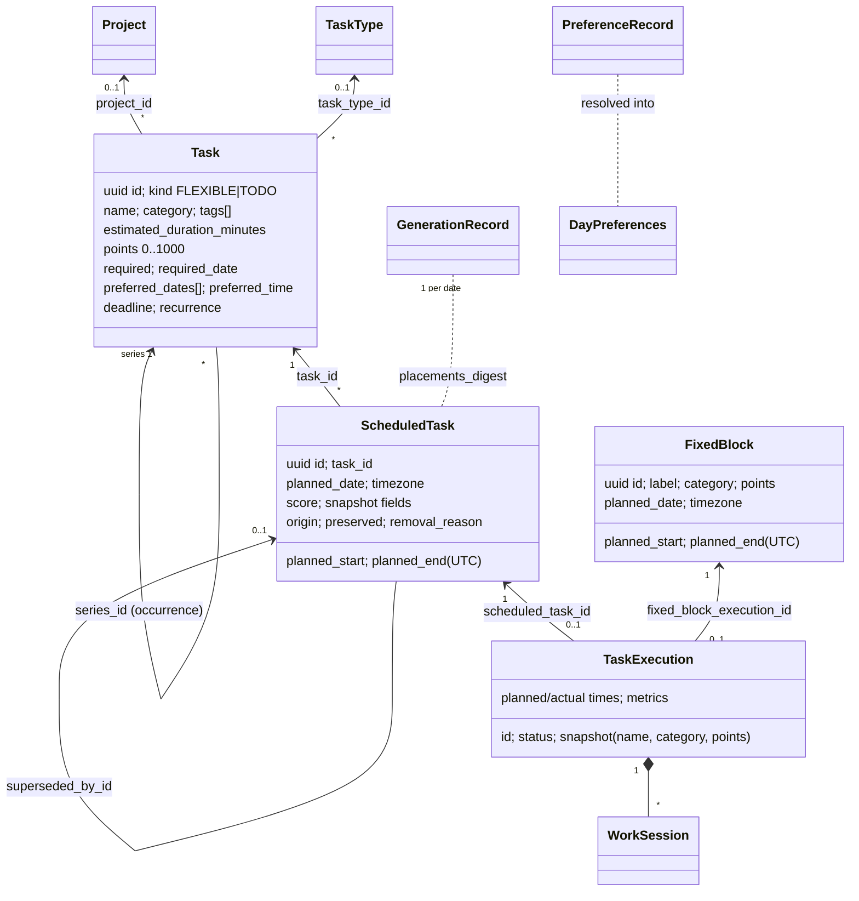

# Architecture

Structural reference for Schedule Maxing: what each part of the repository is, how the parts depend on each
other, and where to change a feature. Runtime behaviour (call order, engine internals, rules and
constraints) is in [WORKFLOW.md](WORKFLOW.md). Companion documents: [CODEBASE_MAP.md](CODEBASE_MAP.md)
(change-impact table and per-change test lists), [CURRENT_STATE.md](CURRENT_STATE.md) (what works today),
[DECISIONS.md](DECISIONS.md) (why, as ADRs) and `docs/` (detailed contracts, linked where relevant).

Verified against commit `abd5da7` (app version 1.3.0, branch `engine-remake`) on 2026-10-27 by reading the
source. Statements marked **(unverified)** could not be confirmed by static inspection.

## Contents

1. [System overview](#1-system-overview)
2. [Repository structure](#2-repository-structure)
3. [File and module reference](#3-file-and-module-reference)
4. [Component dependency map](#4-component-dependency-map)
5. [Data architecture](#5-data-architecture)
6. [Feature-to-file map](#6-feature-to-file-map)
7. [Change impact guide](#7-change-impact-guide)
8. [Application entry points](#8-application-entry-points)
9. [Architectural observations](#9-architectural-observations)
10. [Technologies, configuration and deployment](#10-technologies-configuration-and-deployment)

---

## 1. System overview

A personal scheduling and productivity application. Users enter **flexible tasks** (placed by the
scheduler), **fixed blocks** (immovable commitments) and **To Dos** (checklist items, never placed). A
deterministic engine allocates flexible tasks to dates and then places each date's tasks at minute
precision around hard constraints. The user records what happened (start/pause/complete/skip, timed work
sessions) and earns **points**, which the Productivity page analyses. A Budgeting feature (balance,
recurring income/expenses, forecast) lives alongside but is independent of scheduling. The README's author
note says the product's emphasis has moved from schedule generation towards recording and productivity
tracking; the engine remains the core algorithmic component.

Three deployable parts share one Python 3.10 code base:

| Part | Runs where | Entry point | Storage |
|---|---|---|---|
| Desktop app (CustomTkinter) | User's Windows PC (installer) or from source on any OS with Tk | `app/desktop.py` (production), `app/app.py` (development) | Local SQLite (default) or, dev-only, direct PostgreSQL |
| Backend API (FastAPI) | Render web service | `backend.app:create_app` (factory; `backend/main.py` exposes `app`) | PostgreSQL (SQLAlchemy 2 + Alembic) |
| Local web profile (optional) | Loopback on the user's machine | `python -m app.web` | The desktop's SQLite file (never at the same time as the desktop) |

Also present: a CLI (`python -m app.main`), a productivity report CLI (`app/productivity/report_cli.py`),
backend operator tools (`backend/migrate.py`, `maintenance.py`, `inspect_db.py`, `smoke_check.py`,
`email_diagnostic.py`), Windows packaging (`packaging/windows/`) and offline benchmarks (`benchmarks/`).
**Not in this repository:** the Android client and the browser web UI mentioned in the README;
`docs/web-api.md` is the contract such a UI would use.

### 1.1 Subsystems

| Subsystem | Responsibility | Main location |
|---|---|---|
| Desktop UI | Pages and widgets (Tk thread only) | `app/app.py`, `app/ui/*_page.py`, `*_view.py`, `shell.py` |
| UI logic (controllers) | Tk-free view models returning `ControllerResult` | `app/ui/*_controller.py`, `*_model.py` |
| Composition and threading | Opens storage, builds controllers per workspace, runs work off the Tk thread | `app/ui/app_services.py`, `direct_services.py`, `background.py` |
| Domain models | Canonical Pydantic models (tasks, blocks, placements, executions, preferences) | `app/planning/models.py`, `app/planning/preferences.py`, `app/execution/models.py` |
| Hard constraints | Whether a placement or fixed block is allowed | `app/optimizer.py`, `app/planning/fixed_block_rules.py`, `app/planning/time.py`, `workflow._kept_problems` |
| Reward | How good a valid placement is | `app/reward.py` |
| Engine | Minute-precise day engine; mode objectives; Catch-Up evidence | `app/optimizer.py`, `app/mode_objectives.py`, `app/planning/catch_up.py` |
| Allocation | Task → date for multi-day ranges | `app/planning/allocation.py` |
| Scheduling workflow | Read inputs → allocate → generate per date → save with provenance | `app/planning/workflow.py`, `app/planning/service.py`, `app/planning/provenance.py` |
| Planning application service | Persisted CRUD, ranges, replacement, rescheduling, resets, imports | `app/planning/application.py` (`PlanningService`) |
| Recurrence | Series → concrete occurrences; "this / later / all" edits | `app/planning/series.py`, `recurrence.py`, `occurrence.py` |
| Execution tracking | Lifecycle transitions, sessions, completion metrics | `app/execution/lifecycle.py`, `service.py` |
| Analytics | Tracker, cohorts, day summaries, median predictor | `app/productivity/` |
| Budget | Money in integer minor units, recurrence, forecast | `app/budget/` |
| Local persistence | One SQLite file, ordered migrations, backups, single-process lock | `app/execution/db.py`, `app/planning/repository.py`, `app/execution/repository.py`, `app/budget/repository.py` |
| Sync client | Change capture, outbox, push/pull, conflicts, credentials | `app/sync/` |
| Backend HTTP API | Auth, CRUD, planning API, sync endpoint, change feed | `backend/api.py`, `planning_api.py`, `sync.py`, `*_api.py` |
| Server persistence | Normalized PostgreSQL schema, revisions, change log, Alembic | `backend/models.py`, `backend/mutations.py`, `backend/migrations/` |
| Authentication and security | Argon2id, JWT, sessions, MFA, rate limits, recovery | `backend/accounts.py`, `security.py`, `native_sessions.py`, `browser_sessions.py`, `mfa.py`, `rate_limit.py`, … |
| Background jobs | Desktop worker threads, sync daemon thread, engine process; server email outbox worker | `app/ui/background.py`, `app/sync/service.py`, `app/planning/engine_process.py`, `backend/outbox.py` |
| External integrations | GitHub Releases (updater), mail providers (SMTP/Resend/Brevo/Mailjet), HIBP range API (optional breach check), OS keyring | `app/update/`, `backend/mail.py`, `backend/password_policy.py`, `app/sync/credentials.py` |
| Runtime and packaging | Source vs packaged paths, logging, self-test, installer | `app/runtime.py`, `app/logging_setup.py`, `app/selftest.py`, `packaging/windows/` |

**Key boundary:** one engine, one set of domain services, optional HTTP adapters. The desktop calls
controllers and services in-process and never calls its own HTTP routes; it runs with no server package
installed (`docs/desktop-web-boundaries.md`, enforced by `tests/test_desktop_isolation.py` and the
`desktop-only` CI job). The backend imports the shared domain layer (`app.planning`,
`app.execution.lifecycle`) so the same scheduling and lifecycle rules run on both sides.

---

## 2. Repository structure

Generated, cached and runtime folders (`.venv*`, `__pycache__`, `.pytest_cache`, `.ruff_cache`, `build/`,
`dist/`, `data/`, root `*.log`) and secrets (`.env`) are omitted.

```text
Schedule_Maxing/
├── app/                          desktop app + shared domain layer (also imported by backend/)
│   ├── app.py                    dev entry point; ScheduleOptimizerApp (the CTk window), page wiring
│   ├── desktop.py                production entry point: streams, logging, mutex, --self-test, update check
│   ├── main.py                   CLI: summarize / import CSV -> allocate -> generate one date -> export
│   ├── optimizer.py              canonical day engine generate_day_schedule; evaluate_day_output
│   ├── reward.py                 placement scoring (calculate_task_score); RewardSettings + YAML loading
│   ├── mode_objectives.py        Early Finish / Night Owl metrics, bonus and bounded repacking
│   ├── runtime.py                source vs packaged paths; data/log/backup/update folders
│   ├── logging_setup.py          log files, secret scrubbing, exception hooks
│   ├── selftest.py               packaged-build self-test (--self-test REPORT.json)
│   ├── version.py                the single version string
│   ├── csv_safety.py             spreadsheet-formula neutralising for exports
│   ├── planning/                 canonical planning domain and application services
│   ├── execution/                local SQLite infrastructure + execution tracking
│   ├── productivity/             analytics: tracker, cohorts, day summaries, predictor
│   ├── budget/                   budgeting domain, statistics/forecast, SQLite repository
│   ├── sync/                     offline-first sync client
│   ├── persistence/              optional direct-PostgreSQL desktop storage (dev only)
│   ├── ui/                       CustomTkinter pages/views + Tk-free controllers/models
│   ├── update/                   GitHub-release updater
│   └── web/                      optional loopback FastAPI "local web profile"
├── backend/                      FastAPI server
│   ├── app.py / main.py          create_app factory (middleware, routers, outbox lifespan) / module-level app
│   ├── api.py                    health, auth, CRUD routers, executions, outcomes, days, /changes, /me
│   ├── planning_api.py           /planning/* (allocation preview, generate, reset, reschedule, CSV, recurrence)
│   ├── sync.py                   /sync/capabilities, /sync/push
│   ├── security_api.py, verification_api.py, recovery_api.py, email_webhooks.py
│   ├── mutations.py              Mutator: the one server write path
│   ├── resources.py              wire schemas + per-resource validation (CRUD_RESOURCES, BUDGET_RESOURCES)
│   ├── models.py                 SQLAlchemy ORM (normalized live + revision tables, change log, security)
│   ├── migrations/               Alembic env + versions 0001..0021
│   └── (security, email, operator tools; see 3.10)
├── config/
│   ├── settings.py               env-driven desktop settings (data dir, timezone, backend URL, ...)
│   └── task_preference.yaml      reward template (weights, windows, category multipliers)
├── packaging/windows/            PyInstaller spec, Inno Setup script, build/check/smoke/installer scripts
├── .github/workflows/            ci.yml, release.yml, deploy-backend.yml (+ scripts/pr_tests_passed.sh)
├── tests/                        pytest suite; subfolders mirror app areas; tiers assigned in test_tiers.py
├── benchmarks/                   baseline/performance scripts + recorded results (not run by CI)
├── samples/                      scenario CSV inputs and CLI outputs
├── docs/                         current guides/contracts + historical milestone prompts (docs/README.md)
├── assets/                       icons bundled into the app
├── pyproject.toml                Ruff + pytest configuration (markers)
└── requirements*.txt / .lock     split dependency sets (desktop, direct, database, backend, build, dev)
```

---

## 3. File and module reference

Each central file has a full entry; supporting files are grouped in tables with the same information in
compressed form. "Used by" lists importers found by searching the source (benchmarks and tests omitted
unless notable).

### 3.1 Engine core (`app/`)

**File:** `app/optimizer.py`
- **Purpose:** The canonical day engine. Places one date's flexible tasks around its fixed blocks under hard
  constraints and returns a canonical `DayScheduleOutput`; also recomputes a day's objective for reports.
- **Important classes/functions:** `generate_day_schedule(day_schedule, preferences, *, previous_result,
  task_bonuses)`; `evaluate_day_output` → `DayEvaluation`; `MandatoryTaskSchedulingError` (a `ValueError`
  carrying `failures: list[MandatoryTaskFailure]`); internals `_validate_and_place_canonical_fixed_blocks`,
  `_run_greedy_tier`, `_best_candidate_for_canonical_task`, `_best_start_in_free_interval`,
  `_event_breakpoints`, `_earliest_best_in_continuous_range`, `_preferred_tier_first`,
  `_refine_time_objective`, `_final_scores`, `_free_intervals`; test-only oracle
  `_best_candidate_for_canonical_task_exhaustive`. Constants `ADHD_SHORT_TASK_THRESHOLD_MINUTES = 30`,
  `ADHD_QUARTER_HOUR_MINUTES = 15`.
- **Dependencies:** `app.reward`, `app.planning.models`, `app.planning.preferences`, `app.planning.time`;
  lazily `app.mode_objectives`.
- **Used by:** `app/planning/service.py` (the only production caller of `generate_day_schedule`),
  `app/planning/workflow.py` (`evaluate_day_output`, the error type), `app/ui/planning_controller.py`,
  `app/ui/day_controller.py`, `app/main.py`, `backend/planning_api.py`, benchmarks.
- **Data handled:** in `DaySchedule` + `DayPreferences` (+ optional previous `DayScheduleOutput`, Catch-Up
  bonuses); out `DayScheduleOutput` (placements, unscheduled entries with reason codes, total score).
- **Related features:** Make Schedule (all five modes), Catch-Up, schedule evaluation summaries.

**File:** `app/reward.py`
- **Purpose:** Scores a placement that is already valid. Never decides validity.
- **Important classes/functions:** `RewardSettings` (frozen dataclass, validated finite numbers),
  `ScoringTask`, `Neighbour` (protocol), `calculate_task_score`, `load_reward_settings`; components
  `_weight_score`, `_time_score`, `_relation_score`, `_fragmentation_score`, `_short_gap_bonus_score`.
- **Dependencies:** `app.runtime` (resource root); PyYAML (lazy).
- **Used by:** `app/optimizer.py`, `app/planning/preferences.py`, `app/ui/planning_controller.py`,
  `app/selftest.py`.
- **Data handled:** `config/task_preference.yaml` (≤ 256 KiB, `yaml.safe_load`), score floats rounded to 2
  decimals.
- **Related features:** placement ranking, Settings reward weights.

**File:** `app/mode_objectives.py`
- **Purpose:** Objectives of the Early Finish / Night Owl modes and their bounded repacking.
- **Important:** `schedule_metrics` → `ScheduleMetrics`, `time_bonus`, `mode_weight`, `RepackTask`,
  `refine` → `Refinement`, `_pack`, `_first_fit`, `_last_fit`, `_orders`; `MAX_EXHAUSTIVE_ORDER_TASKS = 6`,
  `EARLY_WEIGHTS = NIGHT_WEIGHTS = (0.50, 0.35, 0.15)`.
- **Dependencies:** standard library only. **Used by:** `app/optimizer.py`, `app/planning/workflow.py`.
- **Data handled:** day-relative integer minute intervals. **Related features:** modes, evaluation summaries.

| File | Purpose / key API | Notes |
|---|---|---|
| `app/runtime.py` | `resource_root`, `resource_path`, `data_dir`, logs/backups/updates folders, `ensure_standard_streams` | The only module that decides source vs packaged |
| `app/logging_setup.py` | `configure_logging`, `install_exception_hooks`, `tk_error_handler`, secret scrubbing | Used by `app/desktop.py` |
| `app/selftest.py` | `run(report_path)`: resources, dependencies, credential store, storage+scheduling, window | Packaged-build check only |
| `app/version.py` | Version string | Release tag must equal it |
| `app/csv_safety.py` | Neutralises formula-leading cells in exports | Used by CSV exporters |

### 3.2 Planning domain and application (`app/planning/`)

**File:** `app/planning/models.py`
- **Purpose:** Canonical Pydantic v2 models every layer builds on.
- **Important classes:** `Task` (kind `FLEXIBLE`/`TODO`, name, category, tags, `estimated_duration_minutes > 0`,
  `points` 0..1000, `required`, `required_date`, `preferred_dates`, `preferred_time` (Early/Mid/Late third),
  legacy `preferred_time_window`, `deadline`, `recurrence`, occurrence identity fields, audit fields);
  `FixedBlock`; `ScheduledTask` (placement: aware UTC instants, `score`, planning snapshot fields,
  `removal_reason`, `superseded_by_id`, `origin`, `preserved`); `Project`, `ProjectMilestone`, `TaskType`,
  `RecurrenceSpec`, `LocalTimeWindow`, `PreferredTime` + `preferred_third_bounds`, `TaskRegistry`,
  `DaySchedule`, `DayScheduleOutput` (validates consistency and `total_score`), `UnscheduledEntry`,
  `UnscheduledReasonCode`, `PlanningDocument`; constants `MAX_TASK_POINTS`, `TODO_PLACEHOLDER_MINUTES`,
  `PLACEMENT_SNAPSHOT_FIELDS`.
- **Dependencies:** `app.planning.time`. **Used by:** essentially every planning, execution, sync,
  productivity and backend module.
- **Related features:** all.

**File:** `app/planning/application.py`
- **Purpose:** `PlanningService`, the persistence-backed boundary for planning data: CRUD with optimistic
  concurrency (`expected_version`), soft deletion, owner scoping, preference layers, fixed-block write
  invariants, scoped placement replacement, Make Schedule's save (`reschedule_range`), explicit
  rescheduling (`reschedule_source`/`apply_reschedule`), resets, imports, history reads.
- **Important:** `PlanningService` (`transaction`, `scoped`, `resolve_preferences`, `load_range`,
  `replace_placements`/`_replace_range`, `reschedule_range`, `placements_for_date`, `preserved_placement_ids`,
  `release_manual_placement`, `schedule_history`, `completion_history`, `clear_range`, `reset_preview`,
  `reset_range`, `apply_import`, `apply_record_batch`, task/project/block/type CRUD), `RangeScope`
  (`ELIGIBLE`, `PLANNED`), `PlanningRange`, `GenerationProvenance`, `RescheduleResult`,
  `PlacementReschedule`, `task_planned_date`, `open_planning_service`.
- **Dependencies:** `app.execution.db`, `app.execution.models`, `app.planning.repository`, `provenance`,
  `occurrence`, `history`, `preferences`, `scope`, `fixed_block_rules`, `errors`.
- **Used by:** `workflow.py`, `series.py`, `csv_canonical.py`, `csv_export.py`, UI controllers,
  `app/ui/app_services.py`, `app/main.py`, `app/web/local_app.py`, `app/persistence/direct.py`,
  `backend/planning_api.py`, `backend/planning_repository.py` (implements its repository interface),
  `backend/sync.py`.
- **Data handled:** all planning tables through the repository; `GenerationRecord` provenance.

**File:** `app/planning/workflow.py`
- **Purpose:** The single scheduling orchestration used by the desktop, the hosted API and the local web
  API: read a consistent input snapshot, allocate, decide what to keep, run the engine per date, save
  atomically after re-checking inputs; freshness; explicit rescheduling.
- **Important:** `read_inputs` → `SchedulingInputs`, `allocate`, `preview_allocation`, `preference_views`,
  `day_freshness` → `DayFreshness`, `generate` → `GenerationOutcome`, `generate_from`, `plan_reservations`
  → `Reservations`/`DayReservation`, `_generate_date`, `_busy_blocks`, `_catch_up_bonuses`,
  `_kept_problems` → `PlacementProblem`, `reschedule_placement`, `reschedule_problems`, `evaluate_outputs`,
  `expand_range`, `check_range`; enums `GenerationMode` (`FULL`, `INCREMENTAL`), `Freshness`
  (`NONE`, `CURRENT`, `STALE`); limits `MAX_RANGE_DAYS = 62`, `MAX_GENERATION_TASKS = 2000`.
- **Dependencies:** `app.optimizer`, `app.mode_objectives`, `allocation`, `application`, `service`,
  `catch_up`, `series`, `occurrence`, `preferences`, `provenance`, `engine_process`, `time`, `errors`.
- **Used by:** `app/ui/planning_controller.py`, `day_controller.py`, `day_page.py`,
  `calendar_controller.py`, `backend/planning_api.py`, `app/persistence/verify_render.py`, benchmarks.

| File | Purpose / key API | Depends on | Used by |
|---|---|---|---|
| `service.py` | `generate_selected_day` (calls the engine exactly once for one date from an allocation), `SelectedDayState`, `DayResultStatus`, `mark_stale_if_outdated`, `week_states` | `optimizer`, `allocation`, `provenance` | `workflow.py`, `ui/planning_controller.py`, `ui/schedule_page_controller.py` |
| `allocation.py` | `allocate_tasks` → `AllocationResult` (task → date, capacity, `UnallocatedEntry` + `AllocationReasonCode`), `_allocation_order`, `_rank_candidate_dates`, `_deadline_allows`, `week_dates`, `month_dates` | `models`, `preferences`, `time` | `workflow.py`, `service.py`, `ui/planning_controller.py`, `ui/calendar_model.py`, `backend/planning_api.py` |
| `preferences.py` | `OptimizerMode` (5 modes), `ENGINE_LABELS`, `ENGINE_DESCRIPTIONS`, `DayWindowSpec`, `RewardPreferences`, `PreferenceOverrides`, `PreferenceRecord`/`PreferenceScope`, `DayPreferences`, `resolve_day_preferences`, `default_preference_template`, `day_preferences_to_reward_settings`, `effective_task_preferred_window` | `reward`, `models`, `time` | engine, workflow, application, Settings UI, `backend/preferences.py` |
| `provenance.py` | `inputs_fingerprint` (`FINGERPRINT_VERSION = 2`), `placements_digest`, `classify_generation`, `GenerationRecord`, `StaleReason` | `models`, `preferences` | `application.py`, `repository.py`, `service.py`, `workflow.py`, `sync/mapping.py`, `ui/day_controller.py`, `backend/planning_repository.py`, `backend/resources.py` |
| `catch_up.py` | `catch_up_evidence`, `summarize`, `CatchUpEvidence.bonus`, `task_bonuses`; `LOOKBACK_DAYS = 90`, `MIN_OUTCOMES = 5` | `execution.models`, `occurrence` | `workflow.py` |
| `engine_process.py` | `run_engine`, `install`, `EngineProcess` (one spawned worker, in-thread fallback) | stdlib | `workflow.py`, `ui/app_services.py` |
| `time.py` | `LocalDayWindow` (`to_utc_instants` refuses DST-crossing windows, `endpoint_instants`), `validate_timezone`, `local_date_of`, `local_instant`, `UnsupportedSchedulingWindowError`, `AmbiguousLocalTimeError`, `MINUTES_PER_DAY` | `zoneinfo` | most planning modules |
| `fixed_block_rules.py` | `check_interval`, `check_no_overlap`, `find_overlap`, `interval_changed`, `neighborhood`, `FixedBlockRuleViolation` | `models`, `preferences`, `time` | `application.py`, `ui/schedule_page_controller.py`, `backend/planning_api.py`, `backend/resources.py` |
| `repository.py` | `PlanningRepository`: the only SQL for planning tables, row mapping, owner scoping, compare-and-update | `execution.db`, `execution.lifecycle`, `execution.models`, `models`, `preferences`, `provenance`, `scope`, `history` | `application.py`, `sync/engine.py`, `ui/app_services.py` |
| `series.py` | `expand_occurrences` → `ExpansionResult`, `edit_occurrence`, `delete_occurrence`, `edit_series`, `delete_series`, `EditScope`, `SeriesChange` | `application`, `recurrence`, `occurrence`, `models`, `time` | `workflow.py`, `ui/planning_controller.py`, `sync/engine.py`, `backend/planning_api.py` |
| `recurrence.py` | `SeriesRule` (slot calendar), `occurrence_task_id` (deterministic UUID), `RecurrenceBudgetError`, `SeriesNotConfiguredError` | `models`, `time` | `series.py`, UI task form |
| `occurrence.py` | `occurrence_key`, `task_occurrence_key`, `HISTORY_PROTECTED_STATUSES` | `models` | workflow, application, catch-up, sync engine |
| `history.py` | `ScheduleHistory`, `CompletionHistory`, `HistoryBounds` read models | `models` | `application.py`, productivity |
| `scope.py` | `OwnerScope` (`account(user_id)`, `ownerless()`) | — | services, repositories, sync, backend adapters |
| `csv_import.py` / `csv_canonical.py` / `csv_export.py` / `compat.py` | Legacy CSV parse + transactional modes (`ImportMode`); canonical stored-planning CSV round trip; export; legacy day-index/minute ↔ canonical adapters | `models`, `application`, `csv_safety` | `ui/planning_controller.py`, `main.py`, `backend/planning_api.py` |
| `execution_facts.py`, `errors.py`, `system_clock.py`, `task_data_reset.py` | `ExecutionFact` (execution slice planning reads); typed `PlanningError` hierarchy (`StaleInputsError`, `VersionConflictError`, `RegenerationRequiredError`, `RescheduleRejectedError`, `GenerationLimitError`, `ScopeError`, …); OS timezone detection; local "Reset All Task Data" | — | services, controllers |

### 3.3 Execution and local storage (`app/execution/`)

**File:** `app/execution/db.py`
- **Purpose:** Owns the single SQLite connection type (`AppConnection`), transaction/lock helpers
  (`transaction`, `locked`), all local table definitions (planning, execution, sync, budget, settings),
  ordered `MIGRATIONS` (`LATEST_SCHEMA_VERSION` = last entry; tests exist through v19), sync capture triggers
  (`_capture_triggers`), integrity checks, legacy `data/` adoption, `resolve_db_path`, `get_connection`,
  CHECK constraint `SCHEDULING_MODES`.
- **Dependencies:** `app.execution.backup`, `config.settings` / `app.runtime` for paths.
- **Used by:** every local repository, `PlanningService`, `ExecutionService`, `SyncStore`, CLI.
- **Related features:** local persistence, migrations, change capture for sync.

| File | Purpose / key API | Notes |
|---|---|---|
| `service.py` | `ExecutionService`: `create_*execution`, `get_or_create_canonical_execution`, `start`, `pause`, `resume`, `complete` (closes sessions, computes duration/variance/start delay), `skip`, `cancel`, `reopen`, `set_outcome(s)`, `record_feedback`, `delete_execution`, `reset_all_history`; `open_execution_service` | Applies `lifecycle.TRANSITIONS`; imports `app.planning.models` |
| `lifecycle.py` | `TRANSITIONS` (7 actions), `TaskOutcome`, `outcome_of`, `outcome_actions`, `reopen_target`, `compute_active_duration_minutes`, `compute_start_delay_minutes` | Pure; shared with `backend/mutations.py`, `executions.py`, `outcomes.py`, `days.py` |
| `repository.py` | `ExecutionRepository`: the only execution SQL | Owner-scoped |
| `models.py` | `TaskExecution`, `WorkSession`, `ExecutionStatus`, `CancelReason` | Snapshot fields (name, category, points) |
| `fixed_block_completion.py`, `direct_completion.py` | Outcomes of fixed blocks (deterministic execution id); completing a task with no placement | |
| `backup.py`, `instance_lock.py` | Copy before migration (with pruning); one process per database file (`DatabaseInUseError`) | |
| `exporters.py`, `errors.py` | Raw execution CSV/JSON export; typed errors | |

### 3.4 Analytics (`app/productivity/`)

`reporting.py` — **`ProductivityService`**, the analytics boundary (`build_tracker_report`,
`build_schedule_cohort_report`, `build_project_points`, `generate_report`, `predict_duration`,
`build_dashboard`). It reads executions (`ExecutionRepository`) and the owner-scoped schedule history
(`PlanningService`). Pure helpers: `tracker.py` (`build_tracker_report`, `read_tracker_data`, awards, points,
averages, streaks), `schedule_cohort.py` (planned vs actual), `day_summary.py` (day aggregates and colour
class), `project_stats.py`, `stats.py`/`segments.py`/`buckets.py`/`filters.py`/`insights.py`/`trends.py`,
`data_prep.py` (executions → observations), `prediction.py` (median-based duration predictor; no ML),
`exporters.py`, `report_cli.py`. Used by `app/ui/app_services.py`, `productivity_controller.py`,
`app/persistence/direct.py`.

### 3.5 Budget (`app/budget/`)

`service.py` (**`BudgetService`**: validation, CRUD, occurrence edits, range expansion, totals, projected
balance) over a repository with a generic interface: `repository.py` (`BudgetRepository`, SQLite) or
`app/persistence/budget.py` (`DirectBudgetRepository`, via the server `Mutator`). `models.py`
(`BudgetBalance`, `BudgetEntry`, `BudgetOverride`, `IncomeIdea`, `WishlistItem`), `money.py` (integer minor
units; floats refused), `recurrence.py`, `stats.py` (`budget_statistics`, `balance_history`,
`balance_forecast` with exact `Fraction` arithmetic), `errors.py`. Nothing in the scheduling stack imports
this package.

### 3.6 Sync client (`app/sync/`)

| File | Purpose / key API |
|---|---|
| `service.py` | **`SyncService`**: `sign_in`/`complete_sign_in` (MFA)/`sign_out`/`restore_session`, registration and recovery helpers, `workspace_scope`, `associate_local_data`, `sync_now` (prepare → push rounds → budget history → pull pages), conflicts, `start`/`wake`/`stop` daemon thread with backoff (`next_delay`) and activity cadence (`set_activity`), `status` |
| `engine.py` | **`SyncEngine`**: `prepare` (dirty records → ordered outbox operations, feature-gated), `next_batch`, `acknowledge`, `refuse`, `apply_pull_page` (capture suppressed), `pull_budget_history`, `conflicts`/`allowed_resolutions`/`resolve`, `association_preview`/`associate_local_data` |
| `store.py` | `SyncStore` SQL for `sync_*` tables (`Account`, `Shadow`, `OutboxOp`, `Conflict`) |
| `mapping.py` | Local record ↔ wire format (`BUDGET_FIELDS` etc.); `execution_changes` |
| `transport.py` | `SyncTransport` interface; `HttpTransport` (stdlib `http.client`, one keep-alive connection, idempotent-only retry); `login_via`, `refresh_via`, typed errors (`TransportError`, `AuthenticationError`, `ProtocolError`) |
| `credentials.py` | `KeyringVault`, `MemoryVault`, `LazyVault` (OS store found on first use or by prefetch) |

### 3.7 Desktop UI (`app/ui/`, `app/app.py`)

**File:** `app/app.py` — `ScheduleOptimizerApp` (`ctk.CTk`): loads UI settings, opens services
(`open_app_services` or `open_direct_app_services`), builds the `AppShell`, builds the Day page eagerly and
every other page as a `DeferredPage`, polls status, handles conflicts dialog, update flow and close; `main()`
parses `--storage` / `--env-file`.

**File:** `app/ui/app_services.py` — `open_app_services` (instance lock → connection/migration →
`PlanningService` + `ExecutionRepository` + `SyncService` → controllers for the current workspace →
`WorkerRegistry` → optional `EngineProcess` → background sync start), `AppServices` (`switch_workspace`,
`data_version`, `workspace_guard`, `budget_controller`, `reset_task_data`, `close`), `describe_startup_failure`.

**File:** `app/ui/background.py` — `ControllerResult` (`ok`, `value`, `error`, `cause`), `WorkerRegistry`
(≤ 4 worker threads, ≤ 64 queued, results delivered by a 10 ms main-thread poll, results dropped for
destroyed widgets or a switched workspace), `run_io`, `run_in_background`, serial lane `WRITE_LANE`.

| Group | Files |
|---|---|
| Shell, navigation, shared widgets | `shell.py` (`AppShell`, page area, `PAGE_SETTLE_MS`, detaching hidden pages), `shell_state.py` (`ShellState`, `PAGE_GROUPS`), `pages.py` (`PageHeader`, `ScrollPage`, `DeferredPage`, `PlaceholderPage`, `SettingsPage`), `layout.py` (`Coalescer`), `components.py`, `paint_widgets.py`, `light_widgets.py`, `theme.py` |
| Threading, lifecycle, diagnostics | `background.py`, `tk_lifecycle.py` (GC on Tk thread, `tune_customtkinter_loops`), `activity.py` (`ActivityState`, `ACTIVITY_POLICIES`), `page_freshness.py`, `diagnostics.py` |
| Planning controllers | `planning_controller.py` (`PlanningController`: Tk-free facade over workflow/service/CSV/preferences; `generate`, `schedule_range`, `generate_day`, `day_freshness`, `reschedule_placement`, `set_engine_mode`), `day_controller.py` (`DayScheduleController.make_schedule_for`/`regenerate_for`), `schedule_page_controller.py`, `calendar_controller.py`, `projects_controller.py` |
| Day page and timeline | `day_page.py` (`DaySchedulePage`), `day_timeline.py`, `day_window.py`, `day_window_bar.py`, `day_outcomes.py`, `task_status_board.py`, `task_status.py`, `task_actions.py`, `day_money.py` |
| Calendars, projects | `calendar_page.py`, `calendar_view.py`, `calendar_model.py`, `selected_day_panel.py`, `planning_pages.py` (`ProjectsPage`) |
| Task form | `task_editor.py`, `task_form_model.py`, `task_defaults.py`, `time_fields.py`, `clock_input.py` |
| Execution | `execution_controller.py` (`ExecutionController`), `execution_workflow.py` |
| Productivity | `productivity_controller.py`, `productivity_page.py`, `tracker_view.py`, `productivity_charts.py`, `history_model.py` |
| Budgeting | `budget_controller.py`, `budget_page.py`, `budget_future.py`, `budget_charts.py` |
| Settings | `settings_controller.py`, `preferences_editor.py`, `preferences_model.py`, `ui_settings.py` |
| Account and sync | `account_controller.py`, `account_page.py`, `conflict_view.py` |
| Updates, guide | `update_controller.py`, `update_view.py`, `guide_page.py`, `guide_content.py` |
| Direct mode composition | `direct_services.py` (`DirectAppServices`, `open_direct_app_services`) |
| Present but not reachable from the app | `feedback_dialog.py`, `cohort_view.py`, `duration_suggestion.py` |

### 3.8 Optional storage and adapters

| File | Purpose |
|---|---|
| `app/persistence/direct.py`, `planning.py`, `executions.py`, `budget.py`, `config.py`, `errors.py`, `verify_render.py` | Dev-only direct PostgreSQL mode: the desktop over the backend's schema, account rules and `Mutator` (no local replica, no sync). `verify_render.py` is a verification helper. |
| `app/web/local_app.py`, `records.py`, `local_session.py`, `__main__.py` | Loopback FastAPI service over the local SQLite file, reusing `build_planning_router` from `backend/planning_api.py`; loopback hosts only |
| `app/update/service.py`, `release_feed.py`, `downloader.py`, `transport.py`, `versioning.py` | GitHub Releases feed → download → SHA256 verify → run installer; numeric version comparison |

### 3.9 Backend (`backend/`)

**File:** `backend/app.py` — `create_app(settings, *, engine, clock, mail)`: loads `BackendSettings`, bounds
password-hashing work, creates the SQLAlchemy engine and session factory, rate limiter, mail adapter, MFA
cipher; installs error handlers and routes (`install_routes` from `api.py`, plus verification, security,
webhooks, recovery, sync and the planning router); middleware (body-size limit, CORS, trusted hosts,
private responses/HSTS); lifespan starts/stops the `OutboxWorker`.

**File:** `backend/mutations.py` — `Mutator`: the only server write path. Serializes a user's mutations via
the `users.change_seq` row lock, checks `base_version` preconditions (409 with current record), writes
server versions and UTC audit fields, appends `change_log` entries referencing immutable revision snapshots.
Used by `api.py`, `sync.py`, `days.py`, `outcomes.py`, `planning_repository.py`, `task_data_reset.py` and the
direct-mode adapters.

**File:** `backend/planning_api.py` — `build_planning_router(context_dependency, capabilities)` mounting
`/planning/*`: capabilities, snapshot, preferences, `allocation/preview`, `generate` (runs
`workflow.generate` with a `GENERATION_TIME_LIMIT_SECONDS` deadline), reset preview/confirm, placement
reschedule/release, recurrence expand, occurrence/series edits, schedule-cohort analytics, CSV
preview/import/export. Shared by the hosted backend and `app/web`.

| Group | Files | Notes |
|---|---|---|
| Routing | `api.py` (health/ready, auth login/refresh/logout/browser session, `/me`, task-data reset, generic CRUD routers from `resources.CRUD_RESOURCES` and `BUDGET_RESOURCES`, executions + actions, placement outcomes, day summaries/outcomes, `/changes`), `sync.py` (`/sync/capabilities`, `/sync/push`), `security_api.py`, `verification_api.py`, `recovery_api.py`, `email_webhooks.py` | `api.current_user_id` is the only identity source |
| Domain on server | `resources.py` (wire schemas, `ResourceSpec`, per-resource validation incl. fixed-block rules), `planning_repository.py` (`ServerPlanningRepository`, implements the `PlanningService` repository interface over SQLAlchemy), `executions.py`, `outcomes.py`, `days.py`, `preferences.py`, `snapshots.py`, `record_mapping.py`, `task_data_reset.py` | Reuses `app.planning` and `app.execution.lifecycle` |
| Storage | `models.py` (ORM; `OPTIMIZER_MODES` CHECK), `database.py` (`create_backend_engine`, `session_factory`), `migrate.py`, `migrations/env.py`, `migrations/normalized_storage.py`, `migrations/versions/0001..0021` | ORM/migration parity is tested |
| Security | `accounts.py`, `passwords.py` (Argon2id), `password_policy.py` (optional HIBP check), `security.py` (JWT HS256), `native_sessions.py`, `browser_sessions.py` (cookie + CSRF), `login_guard.py`, `rate_limit.py`, `mfa.py` (TOTP, Fernet), `account_security.py`, `verification.py`, `recovery.py`, `protection.py`, `security_events.py`, `auth_schemas.py` | |
| Email | `outbox.py` (`OutboxWorker`), `mail.py` (SMTP/Resend/Brevo/Mailjet adapters), `email_webhooks.py`, `email_diagnostic.py` | Requests enqueue; the worker sends |
| Config / errors | `settings.py` (`BackendSettings`, `load_settings`; env only), `errors.py`, `http_errors.py` | |
| Operator tools | `migrate.py`, `maintenance.py`, `inspect_db.py`, `smoke_check.py`, `email_diagnostic.py` | Never mounted as routes |

### 3.10 Configuration, packaging, CI

| File | Purpose |
|---|---|
| `config/settings.py` | Desktop env settings: `SCHEDULE_MAXING_DATA_DIR`, `_TIMEZONE`, `_BACKEND_URL` (default `DEFAULT_BACKEND_URL`, `off` disables), `_UPDATE_REPOSITORY`, `_UPDATE_CHECK`, `_STORAGE`, `_ENV_FILE`, `_GENERATION_PROCESS` |
| `config/task_preference.yaml` | Reward template: weights, preference distances, `category_weights`, `category_time_windows`, `tag_relations` |
| `packaging/windows/launcher.py` | Frozen entry; calls `multiprocessing.freeze_support()` so spawned engine workers do not open a window |
| `packaging/windows/build_windows.ps1`, `ScheduleMaxing.spec`, `ScheduleMaxing.iss`, `check_bundle.py`, `smoke_test.py`, `test_installer.py`, `checksums.py`, `version_info.py`, `make_icon.py` | PyInstaller folder build, bundle check, self-test, Inno Setup installer, SHA256SUMS |
| `.github/workflows/ci.yml`, `release.yml`, `deploy-backend.yml` | CI jobs (`test`, `security-scan`, `desktop-only`, `direct-desktop`, `postgres`); tag-driven Windows release; Render deployment |

---

## 4. Component dependency map

### 4.1 High-level subsystems



### 4.2 Scheduling modules (direct imports)



### 4.3 Execution, sync and server writes



### 4.4 Circular dependencies and coupling

Verified facts:

- **No import cycle at module level** among the files checked; several cycles are avoided by lazy imports
  (`optimizer` → `mode_objectives` inside functions; `planning/task_data_reset.py` imports
  `app.sync.store` inside a function).
- **Package-level bidirectional coupling between `app.planning` and `app.execution`:**
  `planning/application.py` and `planning/repository.py` import `execution.db`, `execution.models` and
  `execution.lifecycle`; `execution/service.py`, `repository.py` and `fixed_block_completion.py` import
  `planning.models`, `planning.scope` and `planning.time`. The cause is historical: `app/execution/db.py`
  owns *every* local table, planning included.
- **`app.planning` ↔ `backend`:** the backend imports the planning domain (one-way). Direct mode
  (`app/persistence/`) imports `backend.mutations` and `backend.planning_repository`, so in that mode the
  desktop depends on the server package (lazily, never in the default desktop path).
- **Wire contract coupling:** `app/sync/mapping.py` (client) and `backend/resources.py` (server) must change
  together; old clients are protected by `GET /sync/capabilities` features.
- **Scheduling-mode list is duplicated** in three places: `OptimizerMode` (`app/planning/preferences.py`),
  `SCHEDULING_MODES` CHECK (`app/execution/db.py`) and `OPTIMIZER_MODES` CHECK (`backend/models.py`).

---

## 5. Data architecture

### 5.1 Core models and relationships



Common to every synchronizable record: `id` (UUID), `user_id` (owner; `None` = guest/ownerless
workspace), `created_at`/`updated_at` (aware UTC), `version` (local edit revision, +1 per logical change),
`deleted_at` (tombstone). Normal reads return live records only.

### 5.2 Engine-facing structures

| Structure | Defined in | Role |
|---|---|---|
| `DaySchedule` | `app/planning/models.py` | Engine input: date, timezone, fixed blocks, `task_ids` (order matters for ties), `TaskRegistry` |
| `DayPreferences` | `app/planning/preferences.py` | Resolved per-date preferences: `day_window` (`DayWindowSpec`), category multipliers/windows, `optimizer_mode`, `reward` |
| `RewardSettings`, `ScoringTask` | `app/reward.py` | What the scorer reads; built per day by `day_preferences_to_reward_settings` and `_canonical_scoring_task` |
| `_Placed` | `app/optimizer.py` | Internal interval in day-relative integer minutes (fixed block, reserved kept work or placed task) |
| `DayScheduleOutput`, `UnscheduledEntry` | `app/planning/models.py` | Engine output |
| `AllocationResult`, `UnallocatedEntry` | `app/planning/allocation.py` | Task → date assignments and capacity |
| `SchedulingInputs`, `Reservations`, `GenerationOutcome`, `PlacementProblem` | `app/planning/workflow.py` | Workflow snapshot, kept-work plan, result, kept-work problems |
| `GenerationRecord` | `app/planning/provenance.py` | Persisted per-date provenance (fingerprint, placements digest, counts, mode) |
| `CatchUpEvidence` | `app/planning/catch_up.py` | Per-category misses/completions over 90 days |

### 5.3 Persistence

**Local SQLite** (`executions.db` in `%LOCALAPPDATA%\ScheduleMaxing`, or `SCHEDULE_MAXING_DATA_DIR`):
created and migrated by `app/execution/db.py` (`MIGRATIONS`, append-only; backup copied first by
`app/execution/backup.py`; a newer schema is refused with `NewerSchemaError`). Table groups: planning
(`projects`, `task_types`, `tasks` + `task_tags`/`task_preferred_dates`/`task_recurrence_weekdays`,
`fixed_blocks`, `scheduled_tasks`, `preference_overrides`, `schedule_generations`), execution (`executions`,
`work_sessions`), sync (`sync_accounts`, `sync_dirty`, `sync_shadows`, `sync_outbox`, `sync_conflicts`,
`sync_control`, `execution_wire_ids`), budget (`budget_balances`, `budget_entries`, `budget_overrides`,
`budget_ideas`, `budget_wishes`) and `local_settings`. SQLite triggers write `sync_dirty` rows in the same
transaction as each write. Only repositories issue SQL: `PlanningRepository`, `ExecutionRepository`,
`BudgetRepository`, `SyncStore`.

**Server PostgreSQL** (`backend/models.py`): normalized live tables; immutable typed revision tables
(`record_revisions` + `*_revisions`) referenced by change-log entries and recorded sync outcomes; per-user
commit-ordered `change_log`; `sync_operations` for idempotency by `op_id`; account/security tables
(sessions, refresh credentials, tokens, MFA, sign-in fingerprints, rate-limit buckets, email outbox).
Alembic revisions `0001`–`0021` (latest: `0021_drop_priority_and_dependencies`).

**Per-device JSON files:** appearance (`app/ui/ui_settings.py`) and task-form defaults
(`app/ui/task_defaults.py`) beside the database. **OS keyring:** the saved refresh credential.

### 5.4 Serialization and validation

- Pydantic v2 validators enforce model invariants (aware datetimes, positive durations, points bounds,
  `planned_end > planned_start`, recurrence identity, `DayScheduleOutput` consistency). See WORKFLOW §4.4.
- Write-time rules beyond the model: fixed-block invariants (`fixed_block_rules.py`), optimistic
  concurrency (`expected_version`), owner immutability (`PlanningService`), server `base_version`
  preconditions (`Mutator`), resource validation (`backend/resources.py`).
- Wire format: JSON via FastAPI/Pydantic schemas in `backend/resources.py` and `backend/auth_schemas.py`;
  client mapping in `app/sync/mapping.py`. Legacy placeholder fields (`priority`, `dependency_ids`) remain on
  the wire for 1.3.0 clients (`LEGACY_*_WIRE_FIELDS`).
- CSV: legacy format (`csv_import.py`, no ids), canonical format 3 with ids (`csv_canonical.py`,
  `csv_export.py`), exports neutralised by `csv_safety.py`.
- Provenance digests: SHA-256 over canonical JSON (`provenance._digest`).

### 5.5 Where data is created, transformed, saved and read

| Data | Created | Transformed | Saved | Read |
|---|---|---|---|---|
| Task / FixedBlock | Task form (`task_form_model.py` → `PlanningController.add_or_update_task` / `save_fixed_block`), CSV import, sync pull, API | Recurrence expansion (`series.expand_occurrences`) creates occurrences | `PlanningService` → `PlanningRepository` | `PlanningService.load_range` (workflow), pages |
| Placement | Engine (`generate_day_schedule`) or explicit reschedule | `_with_category_snapshots` adds snapshots; `_replace_range` assigns owner/origin/version | `PlanningService.reschedule_range` / `apply_reschedule` | Day/Week/Month pages, freshness, history |
| GenerationRecord | `reschedule_range` (one per generated date) | — | `schedule_generations` | `workflow.day_freshness` |
| Execution | First action on a placement / block / direct task (`ExecutionController.get_or_create_*`) | Lifecycle transitions; `complete` computes metrics | `ExecutionRepository` | Analytics, Day board, Catch-Up evidence |
| Preference layers | Settings page / Day preferences (`PlanningController.set_user_overrides`, `set_date_overrides`, `set_engine_mode`) | `resolve_day_preferences` merges layers | `preference_overrides` | `PlanningService.resolve_preferences` |
| Sync ops | SQLite triggers → `sync_dirty`; `SyncEngine.prepare` → `sync_outbox` | `sync/mapping.py` to wire | Server via `Mutator` | `GET /changes` → `apply_pull_page` |

---

## 6. Feature-to-file map

| Feature | Main files | Supporting files | Entry point |
|---|---|---|---|
| Make Schedule (one date) | `app/planning/workflow.py` (`generate`), `app/optimizer.py` | `app/planning/service.py`, `allocation.py`, `provenance.py`, `engine_process.py`, `app/ui/day_controller.py` | Day page button → `DaySchedulePage.make_schedule` (`app/ui/day_page.py`) |
| Full regeneration | `workflow.generate(mode=FULL)` | `PlanningService._replace_range` (supersedes, cancels unstarted executions) | `DaySchedulePage.regenerate` |
| Week / month scheduling | `app/planning/allocation.py`, `workflow.generate_from` | `app/ui/schedule_page_controller.py`, `calendar_controller.py`, `PlanningController.schedule_range` | Week/Month page actions |
| Scheduling modes | `app/optimizer.py`, `app/mode_objectives.py`, `app/planning/catch_up.py` | `app/planning/preferences.py` (`OptimizerMode`), `PlanningController.set_engine_mode` | Day page engine dropdown, Settings, CLI `--mode` |
| Reward weights / preferences | `app/reward.py`, `app/planning/preferences.py` | `config/task_preference.yaml`, `app/ui/preferences_model.py`, `preferences_editor.py`, `settings_controller.py`, `backend/preferences.py` | Settings page |
| Hard constraints | `app/optimizer.py`, `app/planning/fixed_block_rules.py`, `app/planning/time.py` | `workflow._kept_problems`, `reschedule_problems`, `backend/resources.py` | Every generation / block write |
| Freshness ("Current / Out of date") | `app/planning/provenance.py`, `workflow.day_freshness` | `DayScheduleController` status text, `page_freshness.py` (UI redraw skipping, unrelated to provenance) | Day page load |
| Manual move / reschedule | `workflow.reschedule_placement`, `PlanningService.apply_reschedule` | `app/ui/day_timeline.py`, `execution_workflow.py`, `PlanningController.reschedule_placement`, `release_manual_placement` | Day timeline drag/move |
| Recurring tasks | `app/planning/series.py`, `recurrence.py` | `occurrence.py`, `RecurrenceSpec`, `workflow.expand_range` | Task form repeat options |
| Task creation / editing | `app/ui/task_form_model.py`, `task_editor.py` | `task_defaults.py`, `time_fields.py`, `clock_input.py`, `PlanningController.add_or_update_task` | Day page / Projects "Add task" |
| Fixed blocks | `PlanningService.save_fixed_block` | `fixed_block_rules.py`, `PlanningController.save_fixed_block` | Task form (fixed) |
| To Dos | `Task.kind = TODO` in `models.py` | `app/ui/app_services.assign_todo_dates`, Day board | Task form |
| Execution tracking / outcomes | `app/execution/service.py`, `lifecycle.py` | `app/ui/execution_controller.py`, `execution_workflow.py`, `day_outcomes.py`, `task_status_board.py`, `fixed_block_completion.py`, `direct_completion.py` | Day board actions |
| Productivity analytics | `app/productivity/reporting.py`, `tracker.py` | `schedule_cohort.py`, `day_summary.py`, `project_stats.py`, `app/ui/productivity_controller.py`, `productivity_page.py`, `tracker_view.py` | Productivity page; `report_cli.py` |
| Week/Month calendar colours | `app/productivity/day_summary.py` | `app/ui/calendar_model.py`, `calendar_page.py` | Week/Month pages |
| Projects | `app/ui/planning_pages.py` (`ProjectsPage`), `projects_controller.py` | `Project` model, `project_stats.py` | Project Schedule page |
| Budget | `app/budget/service.py` | `models.py`, `money.py`, `recurrence.py`, `stats.py`, `repository.py`, `app/ui/budget_controller.py`, `budget_page.py`, `budget_future.py`, `day_money.py` | Budgeting page, Day money strip |
| CSV import/export | `app/planning/csv_import.py`, `csv_canonical.py`, `csv_export.py` | `compat.py`, `app/csv_safety.py` | Day page menu, CLI `--import-csv`, `/planning/csv/*` |
| Reset (range / all task data) | `PlanningService.clear_range`, `reset_preview`, `reset_range`; `task_data_reset.py` | `AppServices.reset_task_data`, `backend/task_data_reset.py` | Settings / Day menu |
| Local persistence | `app/execution/db.py` | repositories, `backup.py`, `instance_lock.py` | `open_app_services` |
| Accounts / sign-in (desktop) | `app/ui/account_controller.py`, `account_page.py` | `app/sync/service.py`, `transport.py`, `credentials.py` | Settings → Account |
| Synchronization | `app/sync/service.py`, `engine.py` (client); `backend/sync.py`, `mutations.py` (server) | `store.py`, `mapping.py`, `backend/api.py` (`/changes`), `resources.py` | Background thread / "Sync now" |
| Server auth and security | `backend/accounts.py`, `api.py` (auth routes), `security.py` | sessions, MFA, rate limits, verification, recovery modules | `POST /auth/*` |
| Hosted planning API | `backend/planning_api.py` | `workflow.py`, `planning_repository.py` | `POST /planning/generate` etc. |
| Local web profile | `app/web/local_app.py` | `records.py`, `local_session.py` | `python -m app.web` |
| Email | `backend/outbox.py`, `mail.py` | `verification.py`, `recovery.py`, `email_webhooks.py` | Outbox worker (lifespan) |
| Updater | `app/update/service.py` | `release_feed.py`, `downloader.py`, `app/ui/update_controller.py`, `update_view.py` | `ScheduleOptimizerApp.start_update_checks` |
| Packaging / release | `packaging/windows/build_windows.ps1`, `ScheduleMaxing.spec`, `.iss` | `check_bundle.py`, `smoke_test.py`, `app/selftest.py` | `release.yml` on tag `vX.Y.Z` |
| Direct PostgreSQL (dev) | `app/persistence/direct.py`, `app/ui/direct_services.py` | `app/persistence/*.py` | `python -m app.app --storage postgres` |

---

## 7. Change impact guide

Test commands follow `CLAUDE.md`: run focused tests with `python -m pytest -m dev <files>`; `tests/sync`,
`tests/web` and `tests/direct` are system tier (run without `-m dev`). [CODEBASE_MAP.md §D](CODEBASE_MAP.md)
has the full per-change table.

**Scheduling engine (`app/optimizer.py`).** Change search behaviour in the canonical section (after
`MandatoryTaskSchedulingError`). The event search (`_event_breakpoints`) is derived from the exact formulas
in `app/reward.py`: any reward formula change must update the breakpoints, or the search can miss the best
minute — `tests/test_optimizer_differential.py` compares it with the exhaustive oracle. Keep the public
contract: `generate_day_schedule(DaySchedule, DayPreferences, *, previous_result, task_bonuses)` returning a
consistent `DayScheduleOutput`, raising `MandatoryTaskSchedulingError` (a `ValueError`) for required-task
failures, reusing ids of unchanged placements. Hard constraints must never become penalties. Tests:
`tests/test_day_engine.py`, `test_optimizer_candidates.py`, `test_optimizer_differential.py`,
`test_scheduling_modes.py`, `tests/planning/test_generation_characterization.py`; baselines
`python -m benchmarks.scheduling_mode_baseline --check` (Normal/ADHD output is protected).

**Reward (`app/reward.py`) or preference layers (`app/planning/preferences.py`).** Also inspect
`config/task_preference.yaml`, `day_preferences_to_reward_settings`, `backend/preferences.py`,
`app/ui/preferences_model.py`. Resolved `DayPreferences` are hashed into the inputs fingerprint, so adding a
field makes saved days stale once. `weight_importance` also sets the mode weight `W`. Tests:
`tests/test_reward.py`, `tests/planning/test_preferences.py`, `tests/test_scheduling_modes.py`, baselines.

**Adding a scheduling mode.** `OptimizerMode`, `ENGINE_LABELS`, `ENGINE_DESCRIPTIONS`
(`preferences.py`); engine branches (`generate_day_schedule`, `_candidate_starts`, `_refine_time_objective`);
`mode_objectives.py`; `workflow._kept_problems` (mode-specific kept-placement rule, currently ADHD only);
CHECK constraints `SCHEDULING_MODES` (new local migration) and `OPTIMIZER_MODES` (new Alembic revision); the
sync feature gate (`SCHEDULING_MODES_FEATURE`); `docs/scheduling-modes.md`.

**Allocation (`app/planning/allocation.py`).** `_allocation_order` and `_rank_candidate_dates` are the
policy. The order of `AllocationResult.assignments` becomes the engine's `task_ids` order, which is the
engine's final tie-break, so reordering allocation can change day output. Tests:
`tests/planning/test_allocation.py`, `test_allocation_service.py`, week baselines.

**Scheduling workflow (`app/planning/workflow.py`).** Contracts to keep: `GenerationOutcome.status` values
(`generated`, `already_current`, `nothing_placed`), the "write nothing on failure" rule, kept-work rules
(history never moves, manual intent blocks until released), the re-read inside the write transaction. Any
caller-visible change affects the desktop (`PlanningController`, `DayScheduleController`), the hosted API
(`backend/planning_api.py`) and the local web profile together. Tests: `tests/planning/test_workflow.py`,
`test_manual_placements.py`, `test_explicit_rescheduling.py`, `tests/ui/test_desktop_generation_workflow.py`,
`tests/backend/test_planning_api.py`.

**Provenance (`app/planning/provenance.py`).** Changing what is hashed requires bumping
`FINGERPRINT_VERSION` (old records then report `INPUTS_CHANGED`). Inspect `PlanningRepository`
(`schedule_generations` row mapping), `backend/planning_repository.py`, `backend/resources.py`,
`app/sync/mapping.py`.

**Task model attribute.** Local: `models.Task`, `PlanningRepository` row mapping, a new migration in
`app/execution/db.py`. Server: `backend/models.py` + Alembic revision, `record_mapping.py`, `resources.py`,
`snapshots.py`. Sync: `app/sync/mapping.py`. CSV: `csv_canonical.py`, `csv_export.py`. UI:
`task_form_model.py`, `task_editor.py`. Fingerprint: content fields are hashed automatically.

**Local schema (`app/execution/db.py`).** Append a migration; never edit an applied one; add capture
triggers for synchronizable tables; add `tests/execution/test_migration_vN.py`.

**Server schema.** `backend/models.py` + new revision; revision tables change with live tables; direct mode
shares the schema. Run `tests/backend/test_migrations.py` and `test_normalized_migration.py` (slow tier).

**Execution lifecycle (`app/execution/lifecycle.py`).** Shared by `ExecutionService`, `backend/mutations.py`,
`backend/executions.py`, `outcomes.py`, `days.py`, direct `app/persistence/executions.py`, sync
`mapping.execution_changes`, UI `execution_controller.py`, `task_status.py`. Tests:
`tests/execution/test_service.py`, `test_task_outcomes.py`, `tests/backend/test_executions.py`.

**Sync.** Client `app/sync/engine.py` with `store.py`, `mapping.py`, `service.py`; server `backend/sync.py`,
`mutations.py`, `api.py` (`/changes`). Keep idempotency by `op_id`, capability-gated record types and the
legacy wire placeholders. Tests: `tests/sync/*` (system tier), `tests/backend/test_sync_push.py`,
`test_change_log.py`.

**UI.** Logic goes in Tk-free controllers; widgets in `*_page.py`/`*_view.py`. Storage calls must run through
`run_in_background`/`run_io`; writes on `WRITE_LANE`. Workers never touch Tk. Tests: controller tests in
`tests/ui/` (dev tier), real-window tests only when layout/behaviour of widgets changes.

**Backend endpoint.** Router module + include it in `backend/app.py`; identity only via
`api.current_user_id`; writes only through `Mutator`; error shape from `errors.py`; update
`docs/web-api.md`; add client code in `app/sync/transport.py` if the desktop calls it.

**Desktop dependency isolation.** Never import FastAPI/SQLAlchemy/psycopg at module level in code the
desktop loads; `tests/test_desktop_isolation.py` (slow) guards it.

---

## 8. Application entry points

| Entry | Starting function | High-level chain |
|---|---|---|
| Packaged desktop | `packaging/windows/launcher.py` → `app.desktop.main` | `freeze_support()` → `start_runtime` (streams, logging, exception hooks, instance mutex) → `--self-test`? `selftest.run` : `_build_window` → `ScheduleOptimizerApp(storage="local")` → `start_update_checks` → `mainloop()` |
| Desktop from source | `python -m app.app` → `app.app.main` | parse `--storage`/`--env-file` → `ScheduleOptimizerApp.__init__` → `open_app_services` (or `open_direct_app_services`) → `_build_shell` → `show_page("day")` → `mainloop()` |
| Make Schedule (user action) | `DaySchedulePage.make_schedule` (`app/ui/day_page.py`) | `run_in_background(WRITE_LANE)` → `DayScheduleController.make_schedule_for` → `PlanningController.generate` → `workflow.generate` → … → `generate_day_schedule` (detail in WORKFLOW §2) |
| CLI | `python -m app.main` → `app.main.main` | `get_connection` → `PlanningService` + `PlanningController` → optional `set_engine_mode`, CSV import → `allocate_range` → `generate_day` (`workflow.generate_from`) → print/export |
| Productivity report CLI | `python -m app.productivity.report_cli` → `main` | `ProductivityService.generate_report` → text/JSON/CSV |
| Local web profile | `python -m app.web` → `app.web.__main__.main` | loopback check → `local_app` FastAPI over SQLite → uvicorn |
| Backend HTTP | `uvicorn --factory backend.app:create_app` (or `backend.main:app`) | `create_app` → routers; each request → dependency `current_user_id` → handler → `Mutator` / `workflow` → JSON |
| Backend background job | `OutboxWorker.start` in `create_app`'s lifespan | polls `email_outbox`, sends through `mail.py` adapter |
| Desktop background jobs | `WorkerRegistry` threads; `SyncService.start` daemon thread; `EngineProcess` (spawned process); `tk_lifecycle` GC timer; status poll (`ACTIVITY_POLICIES`) | see WORKFLOW §1 |
| Migrations | `python -m backend.migrate upgrade` (Render pre-deploy); local migrations run inside `get_connection` | Alembic / `app/execution/db.py` `MIGRATIONS` |
| Operator tools | `python -m backend.maintenance`, `backend.inspect_db`, `backend.smoke_check`, `backend.email_diagnostic` | CLI scripts |
| Benchmarks | `python -m benchmarks.scheduling_mode_baseline [--check]` and others | Call the engine directly |
| Tests | `pytest` (`tests/conftest.py`, tiers from `tests/test_tiers.py`) | `pytest -m dev` for the development suite |
| Scheduled tasks | None in the application. CI/CD runs on GitHub events only (`ci.yml`, `release.yml`, `deploy-backend.yml`) | — |

---

## 9. Architectural observations

### 9.1 Verified design decisions (from code)

- **Modes are objectives over one search**, not separate optimizers (`OptimizerMode` docstring,
  `mode_objectives.py`). Normal and ADHD share the exact baseline search.
- **Hard constraints are checked before scoring and never become penalties**; the reward module only ranks
  allowed placements (`reward.py` docstring; engine prunes to free intervals and deadline-bounded starts).
- **Analytic candidate search with an independent oracle**: the production search scores only breakpoint
  candidates; `_best_candidate_for_canonical_task_exhaustive` exists solely for tests.
- **Determinism**: no randomness; ties resolve by earliest start, then input order. This allows running the
  engine in a separate process (`engine_process.py`) with identical results.
- **Stateless workflow with optimistic checks**: the engine runs outside any write transaction; the save
  re-reads inputs and compares fingerprints and a reservations token.
- **History is immutable**: started/finished placements are never moved; executions snapshot task data.
- **Desktop/server code reuse**: the backend's `ServerPlanningRepository` implements the
  `PlanningRepository` interface so `PlanningService` and `workflow` run unchanged on PostgreSQL.
- **Single write path on the server** (`Mutator`) and single SQL owner per table locally (repositories).

### 9.2 Coupling and fragility (potential concerns, not defects)

- **Large modules**: `app/planning/application.py` (~2.3k lines), `app/execution/db.py` (~1.8k),
  `backend/models.py` (~1.7k), `app/productivity/tracker.py`, `app/sync/engine.py`,
  `app/optimizer.py` (~1.3k). `ROADMAP.md` lists maintainability work.
- **Ownership of tables**: all local tables, including planning and sync, live in `app/execution/db.py`.
- **Reward ↔ engine formula coupling**: `_event_breakpoints` hand-derives breakpoints from each reward
  component; changing a reward formula without updating the search silently degrades optimality (guarded
  only by the differential tests).
- **Mode list in three places** (enum + two CHECK constraints), plus a sync feature flag.
- **Kept-work validation duplicates engine rules**: `workflow._kept_problems` re-implements window, overlap,
  deadline, duration and ADHD-grid checks separately from the engine.
- **Stale docstring text**: `app/planning/application.py` still says "Dependency cycles are stored as given
  … detecting them is the PERT layer's job" although tasks no longer have dependencies (removed in
  `92c6993`); the code itself has no dependency handling.
- **Two allocation-state models**: in-memory `SelectedDayState`/`mark_stale_if_outdated`
  (`planning/service.py`) and persisted provenance (`provenance.py`). The controller derives state from
  provenance; the in-memory rule remains for callers that hold states.
- **Unreached UI modules**: `feedback_dialog.py`, `cohort_view.py`, `duration_suggestion.py` are not wired.
- **`weight_category_bonus`** is carried through settings and storage but read by no reward component.

---

## 10. Technologies, configuration and deployment

| Concern | Choice | Declared in |
|---|---|---|
| Language | Python 3.10 | workflows, `build_windows.ps1` |
| Desktop UI | CustomTkinter on Tk, `ttk.Treeview` | `requirements-desktop.txt` |
| Models | Pydantic v2 | `app/planning/models.py`, `app/execution/models.py` |
| Local storage | stdlib `sqlite3`, hand-written migrations | `app/execution/db.py` |
| Device credentials | `keyring` | `app/sync/credentials.py` |
| Client HTTP | stdlib `http.client` (sync), `urllib` (updater) | `app/sync/transport.py`, `app/update/transport.py` |
| Server | FastAPI, Starlette, Uvicorn | `requirements-backend.txt` |
| Server storage | SQLAlchemy 2, Alembic, psycopg 3 (SQLite for ordinary tests) | `requirements-database.txt` |
| Server auth | argon2-cffi, PyJWT, pyotp, cryptography | `backend/passwords.py`, `security.py`, `mfa.py` |
| Packaging | PyInstaller + Inno Setup 6 | `packaging/windows/` |
| CI/CD | GitHub Actions; Render (backend); GitHub Releases (desktop) | `.github/workflows/` |
| Lint / tests | Ruff, pytest with automatic tiers | `pyproject.toml`, `tests/test_tiers.py` |

- **Desktop configuration:** `config/settings.py` (see 3.10). Reward defaults from
  `config/task_preference.yaml` via `app.runtime.resource_root()`.
- **Backend configuration:** environment variables only (`backend/settings.py`); names are catalogued in
  [CODEBASE_MAP.md](CODEBASE_MAP.md#backend-configuration-names).
- **Desktop delivery:** tag `vX.Y.Z` equal to `app/version.py` → `release.yml` builds on Windows → GitHub
  Release → in-app updater verifies SHA256 and runs the installer.
- **Backend delivery:** `deploy-backend.yml` deploys a `main` commit whose PR passed CI (gated by
  `BACKEND_DEPLOY_ENABLED`), then checks `/health` and `/ready`; migrations run as the pre-deploy command.
- **Constraints:** the desktop must run with only `requirements-desktop.txt`; only `app/runtime.py` decides
  source vs packaged; one process per local database; one SQLite connection per desktop session
  (serialized by design); no overnight or DST-transition day windows; direct PostgreSQL mode is never part of
  a distributed build.
