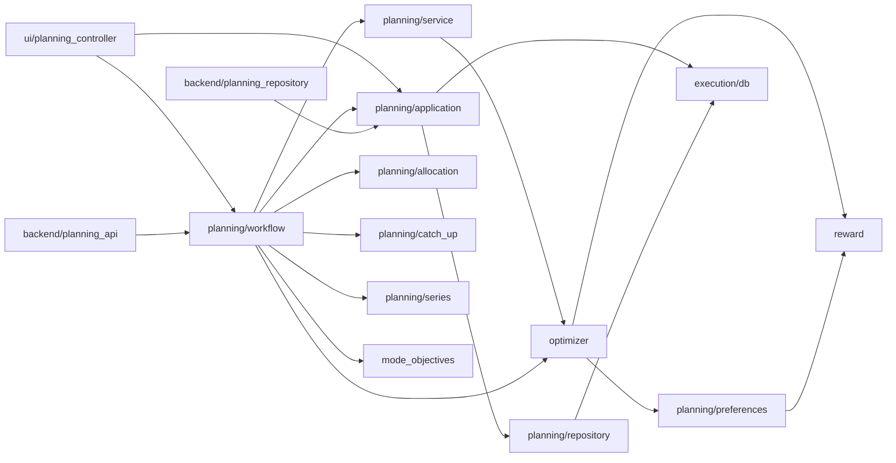
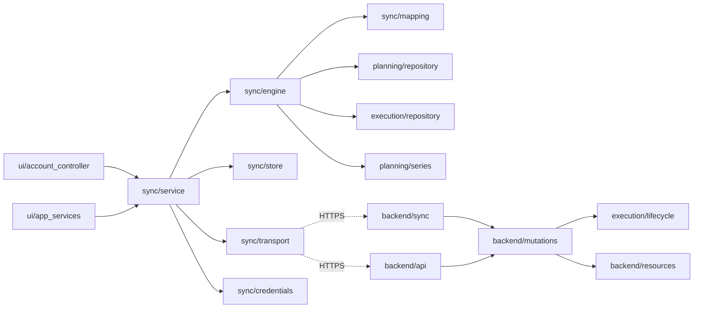

# Codebase map

A navigation and change-impact guide. Use section D first: find the change you need, open the
"Start here" files, follow only the listed dependencies, run the listed tests. System design is in
[ARCHITECTURE.md](ARCHITECTURE.md); run-time behaviour (call chains, engine internals, rules and constraints)
in [WORKFLOW.md](WORKFLOW.md); feature status in [CURRENT_STATE.md](CURRENT_STATE.md).

Paths verified against commit `c2b19c0` on 2026-10-24. Dependencies marked **(import)** were checked in
the source; others are call-level or conceptual relationships.

## A. Repository structure

```text
app/                    desktop application and the shared domain layer (also imported by backend/)
  app.py                development entry point; ScheduleOptimizerApp window and page wiring
  desktop.py            production entry point (packaged exe): streams, logging, mutex, self-test, update check
  main.py               CLI: import CSV -> allocate -> generate -> export
  reward.py             placement scoring (typed ScoringTask); RewardSettings from config/task_preference.yaml
  optimizer.py          canonical generate_day_schedule + mode refinement
  mode_objectives.py    Early Finish / Night Owl metrics and repacking
  runtime.py            source vs packaged, resource_path, data/logs/backups/updates folders
  logging_setup.py      log files, secret scrubbing, exception hooks
  selftest.py           packaged self-test (--self-test REPORT.json)
  version.py            the single version string
  csv_safety.py         spreadsheet-formula neutralising for exports
  planning/             canonical planning domain + application services (see C.2)
  execution/            local SQLite infrastructure + execution tracking (see C.3)
  productivity/         analytics, tracker, cohort, median predictor (see C.4)
  budget/               budgeting domain: money, models, recurrence, BudgetService, stats/forecast, SQLite repository (see C.3a)
  sync/                 offline-first sync client (see C.5)
  persistence/          optional direct-PostgreSQL desktop storage (dev only)
  ui/                   CustomTkinter pages/views + Tk-free controllers/models (see C.6)
  update/               GitHub-release updater (feed, download, verify, install)
  web/                  optional loopback FastAPI "local web profile"
backend/                FastAPI server (see C.7); migrations/ = Alembic env + 21 versions
config/                 settings.py (env-driven desktop settings) + task_preference.yaml (reward defaults)
packaging/windows/      build_windows.ps1, ScheduleMaxing.spec, .iss, check_bundle, smoke_test, test_installer
.github/                workflows ci.yml, release.yml, deploy-backend.yml; scripts/pr_tests_passed.sh
tests/                  pytest suite; subfolders mirror app areas (backend, sync, direct, web, ui, ...)
benchmarks/             standalone performance/baseline scripts and recorded results (not run by CI)
docs/                   current guides and contracts + historical milestone plans (see docs/README.md)
samples/                scenario CSV inputs and regenerated CLI outputs
assets/                 icons bundled into the app
```

Ignore: `.venv*`, `__pycache__`, `.pytest_cache`, `.ruff_cache`, `build/`, `dist/`, root `*.log` files,
`data/` (legacy runtime data), `.env` (secrets; never read it).

## B. Feature-to-file mapping

| Feature | Primary files | Supporting files | Tests | Related |
|---|---|---|---|---|
| Application start-up | `app/desktop.py`, `app/app.py`, `app/ui/app_services.py` | `app/runtime.py`, `app/logging_setup.py`, `app/execution/instance_lock.py`, `app/execution/backup.py`, `config/settings.py` | `tests/test_desktop_entry.py`, `tests/ui/test_app_services.py`, `tests/test_runtime.py`, `tests/test_logging_setup.py` | Packaging, persistence |
| Task creation/editing (UI) | `app/ui/task_editor.py`, `app/ui/task_form_model.py` | `app/ui/task_defaults.py`, `time_fields.py`, `clock_input.py`, `app/ui/planning_controller.py` | `tests/ui/test_task_form_model.py`, `test_task_editor_widgets.py`, `test_task_defaults.py` | Planning models, fixed-block rules |
| Task/record model | `app/planning/models.py` | `app/planning/repository.py`, `backend/resources.py`, `backend/record_mapping.py`, `app/sync/mapping.py` | `tests/planning/test_models.py`, `test_planning_repository.py`, `test_task_types_and_snapshots.py` | Every layer |
| Persisted planning (CRUD, ranges, resets) | `app/planning/application.py` (`PlanningService`) | `app/planning/repository.py`, `errors.py`, `scope.py`, `task_data_reset.py` | `tests/planning/test_application_service.py`, `test_reset.py`, `test_owner_scope.py`, `test_concurrency.py` | Sync capture triggers |
| Scheduling (day engine, modes) | `app/optimizer.py`, `app/mode_objectives.py` | `app/planning/catch_up.py`, `app/planning/preferences.py`, `app/planning/time.py`, `app/reward.py`; desktop runs it through `app/planning/engine_process.py` | `tests/test_day_engine.py`, `test_scheduling_modes.py`, `test_optimizer_candidates.py`, `test_optimizer_differential.py`, `tests/test_engine_process.py` | `benchmarks/scheduling_mode_baseline.py --check` |
| Scheduling workflow (generate/save/freshness) | `app/planning/workflow.py` | `app/planning/service.py`, `allocation.py` (points-first order), `provenance.py` | `tests/planning/test_workflow.py`, `test_allocation*.py`, `tests/ui/test_desktop_generation_workflow.py` | Day page, backend `planning_api.py` |
| Reward / preferences | `app/reward.py`, `app/planning/preferences.py` | `config/task_preference.yaml`, `backend/preferences.py`, `app/ui/preferences_model.py`, `preferences_editor.py` | `tests/test_reward.py`, `tests/planning/test_preferences.py`, `tests/ui/test_settings_controller.py` | Settings page, Day Preferences |
| Hard constraints | `app/optimizer.py` (canonical engine checks), `app/planning/fixed_block_rules.py`, `app/planning/time.py` | `app/planning/compat.py` | `tests/test_day_engine.py`, `tests/planning/test_fixed_block_rules.py`, `tests/backend/test_fixed_block_writes.py` | Allocation, engine |
| Recurring tasks | `app/planning/recurrence.py`, `app/planning/series.py` | `app/planning/occurrence.py`, `RecurrenceSpec` in `models.py` | `tests/planning/test_recurrence_*.py`, `tests/ui/test_recurrence_desktop.py`, `tests/sync/test_recurrence_sync.py`, `tests/backend/test_recurrence_api.py` | `docs/recurrence.md` |
| Rescheduling / manual placements | `app/planning/workflow.py: reschedule_placement`, `PlanningService.apply_reschedule` | `app/ui/execution_workflow.py`, `app/ui/day_timeline.py` | `tests/planning/test_explicit_rescheduling.py`, `test_manual_placements.py`, `tests/sync/test_rescheduling_sync.py` | `docs/execution-rescheduling.md` |
| CSV import/export | `app/planning/csv_import.py`, `csv_canonical.py`, `csv_export.py` | `app/planning/compat.py`, `app/csv_safety.py`, `app/main.py` | `tests/planning/test_csv_*.py`, `tests/test_import_safety.py`, `tests/test_main_cli.py` | Day page, `/planning/csv/*` |
| Execution tracking | `app/execution/service.py`, `lifecycle.py` | `repository.py`, `models.py`, `fixed_block_completion.py`, `direct_completion.py`, `app/ui/execution_controller.py`, `execution_workflow.py` | `tests/execution/test_service.py`, `test_canonical_service.py`, `test_task_outcomes.py`, `tests/ui/test_execution_*.py` | Backend `executions.py`, `outcomes.py` |
| Day board / outcomes | `app/ui/day_page.py`, `app/ui/day_controller.py` | `day_timeline.py`, `day_outcomes.py`, `task_status_board.py`, `task_status.py`, `task_actions.py`, `day_window*.py` | `tests/ui/test_day_*.py`, `test_task_status.py` | `app/productivity/day_summary.py` |
| Week/Month calendars | `app/ui/calendar_page.py`, `calendar_controller.py` | `calendar_model.py`, `calendar_view.py`, `selected_day_panel.py` | `tests/ui/test_calendar_*.py` | Day summaries |
| Projects | `app/ui/planning_pages.py` (`ProjectsPage`), `app/ui/projects_controller.py` | `Project`/`ProjectMilestone` in `models.py`, `app/productivity/project_stats.py` | `tests/ui/test_projects_allocation.py`, `test_project_details.py`, `test_planning_pages.py` | Productivity Project section |
| Budget (balance, income/expenses, recurrence, Future items) | `app/budget/service.py` (`BudgetService`) | `app/budget/models.py`, `money.py`, `recurrence.py`, `stats.py`, `repository.py`; direct `app/persistence/budget.py`; server `BUDGET_*` specs in `backend/resources.py`; sync `app/sync/mapping.py` (`BUDGET_FIELDS`) | `tests/budget/*`, `tests/execution/test_migration_v17.py`, `test_migration_v18.py`, `tests/backend/test_budget_api.py`, `tests/sync/test_budget_sync.py`, `tests/direct/test_direct_budget.py` | Budgeting page, Day money widgets |
| Budgeting page (General / Stats / Future) | `app/ui/budget_page.py` (`BudgetingPage`), `app/ui/budget_controller.py` (`BudgetController`) | `budget_future.py`, `budget_charts.py`; composition `AppServices.budget_controller()` / `DirectAppServices.budget_controller()`; wiring `app/app.py: _build_workspace_pages`, nav `shell_state.py` | `tests/ui/test_budget_controller.py`; real-window `tests/ui/test_budget_page.py` | `app/budget/stats.py` |
| Day page money widgets | `app/ui/day_money.py` (`MoneyTotals`, `MoneyStrip`, `DayMoneyDialog`) | `app/ui/day_page.py` (`_show_money`, `open_money`, `_save_money`), `BudgetController.day` / `set_day_amounts` | `tests/ui/test_budget_controller.py`; real-window `tests/ui/test_budget_page.py` | Budgeting page |
| Productivity analytics | `app/productivity/reporting.py`, `tracker.py` | `stats.py`, `segments.py`, `day_summary.py`, `schedule_cohort.py`, `app/planning/history.py`, `app/ui/productivity_controller.py`, `productivity_page.py`, `tracker_view.py`, `productivity_charts.py` | `tests/productivity/test_tracker*.py`, `test_reporting.py`, `test_schedule_cohort*.py`, `tests/ui/test_productivity_*.py`, `test_tracker_view.py` | `docs/analytics.md` |
| Duration prediction | `app/productivity/prediction.py` | `app/ui/duration_suggestion.py` (not wired) | `tests/productivity/test_prediction.py` | Median-based only |
| Settings / preferences UI | `app/ui/pages.py` (`SettingsPage`), `app/ui/settings_controller.py` | `preferences_editor.py`, `preferences_model.py`, `ui_settings.py`, `task_defaults.py` | `tests/ui/test_settings_page.py`, `test_settings_controller.py` | Reward/preferences |
| Desktop shell / navigation (page groups: Settings / Account / How to Use) | `app/ui/shell.py`, `shell_state.py` | `layout.py`, `components.py`, `paint_widgets.py`, `theme.py`, `guide_page.py`, `guide_content.py` | `tests/ui/test_desktop_shell.py`, `test_shell_foundation.py`, `test_guide.py` | All pages |
| UI responsiveness | `app/ui/background.py` | `tk_lifecycle.py`, `diagnostics.py`, `layout.py`, `paint_widgets.py`, `activity.py`, `page_freshness.py`, `pages.py` (`DeferredPage`), `shell.py` (page size) | `tests/ui/test_background_executor.py`, `test_async_storage.py`, `test_responsiveness_regressions.py`, `test_bounded_rendering.py`, `test_deferred_pages.py`, `test_page_freshness*.py`, `test_activity*.py`, `tests/test_startup_cost.py` (helper: `tests/tk_cleanup.py`) | `benchmarks/desktop_responsiveness.py`, `docs/desktop-responsiveness-*.md`, `docs/desktop-performance-round3.md` |
| Local persistence (SQLite) | `app/execution/db.py` | `app/planning/repository.py`, `app/execution/repository.py`, `backup.py`, `instance_lock.py` | `tests/execution/test_db.py`, `test_migration_v*.py`, `test_backup.py`, `test_transactions.py`, `tests/ui/test_data_compatibility.py` | Sync triggers |
| Synchronization (client) | `app/sync/service.py`, `engine.py` | `store.py`, `mapping.py`, `transport.py`, `credentials.py` | `tests/sync/*` (system tier), `tests/test_transport_security.py`, `tests/test_sync_status_counts.py` | `docs/sync-protocol.md` |
| Synchronization (server) | `backend/sync.py`, `backend/mutations.py` | `backend/snapshots.py`, `backend/api.py` (`/changes`), `backend/resources.py` | `tests/backend/test_sync_push.py`, `test_change_log.py`, `test_isolation.py` | Client sync |
| Accounts / authentication (server) | `backend/accounts.py`, `backend/api.py` (auth routes), `backend/security.py` | `passwords.py`, `password_policy.py`, `native_sessions.py`, `browser_sessions.py`, `login_guard.py`, `rate_limit.py`, `mfa.py`, `account_security.py`, `security_api.py`, `verification*.py`, `recovery*.py` | `tests/backend/test_auth*.py`, `test_account_*.py`, `test_native_sessions.py`, `test_email_verification.py`, `test_api_security.py` | `docs/account-security.md` |
| Accounts (desktop) | `app/ui/account_controller.py`, `account_page.py` | `conflict_view.py`, `app/sync/service.py`, `app/sync/credentials.py`, `app/sync/transport.py` | `tests/sync/test_desktop_account_*.py`, `test_keep_signed_in.py`, `test_local_first_accounts.py` | `docs/desktop-accounts.md` |
| API communication (client) | `app/sync/transport.py` (`HttpTransport`) | `app/update/transport.py` (GitHub only) | `tests/sync/test_http_transport.py`, `tests/test_transport_security.py`, `tests/test_transport_keepalive.py` | Backend routes |
| Backend HTTP API | `backend/app.py` (`create_app`), `backend/api.py`, `backend/planning_api.py` | `errors.py`, `http_errors.py`, `protection.py`, `resources.py`, `days.py`, `outcomes.py`, `executions.py` | `tests/backend/test_resources.py`, `test_planning_api.py`, `test_days_api.py`, `test_server_security.py` | `docs/web-api.md`, `docs/backend.md` |
| Server schema / migrations | `backend/models.py`, `backend/migrations/versions/` | `backend/migrate.py`, `record_mapping.py`, `snapshots.py`, `migrations/normalized_storage.py` | `tests/backend/test_migrations.py`, `test_normalized_*.py`, `test_postgres.py` | Direct mode |
| Email | `backend/outbox.py`, `backend/mail.py` | `email_webhooks.py`, `email_diagnostic.py`, `verification.py`, `recovery.py` | `tests/backend/test_email_verification.py`, `test_account_recovery.py` | `docs/email.md` |
| Direct PostgreSQL mode | `app/persistence/direct.py`, `app/ui/direct_services.py` | `app/persistence/planning.py`, `executions.py`, `config.py`, `errors.py`, `verify_render.py` | `tests/direct/*` | `docs/direct-postgres.md` |
| Local web profile | `app/web/local_app.py` | `records.py`, `local_session.py`, `__main__.py` | `tests/web/*` | `docs/web-api.md#local-profile` |
| Updater | `app/update/service.py` | `release_feed.py`, `downloader.py`, `transport.py`, `versioning.py`, `app/ui/update_controller.py`, `update_view.py` | `tests/update/*` | Release workflow |
| Windows packaging/release | `packaging/windows/build_windows.ps1`, `ScheduleMaxing.spec`, `ScheduleMaxing.iss` | `check_bundle.py`, `smoke_test.py`, `test_installer.py`, `checksums.py`, `version_info.py`, `app/selftest.py` | `tests/test_packaging_config.py`, `test_release_workflow.py` | `docs/windows-distribution.md` |
| CI/CD | `.github/workflows/ci.yml`, `release.yml`, `deploy-backend.yml` | `.github/scripts/pr_tests_passed.sh`, `secret-scan-baseline.json`, `requirements.lock` | `tests/test_workflows.py`, `test_deploy_workflow.py`, `test_release_workflow.py` (helper: `tests/workflow_files.py`) | `docs/ci-cd.md` |
| Configuration | `config/settings.py` | `config/task_preference.yaml`, `backend/settings.py`, `app/persistence/config.py`, `.env.example` | `tests/test_runtime.py`, `tests/backend/test_health_config.py`, `tests/direct/test_direct_config.py` | — |

## C. File responsibilities

Grouped by package. Short paths inside a table are relative to that section's package (for example
`planning/service.py` in C.1 is `app/planning/service.py`). "Used by" lists verified importers unless noted.

### C.1 Engine core (`app/`)

| File | Responsibility and key API | Depends on (import) | Used by | Constraints |
|---|---|---|---|---|
| `optimizer.py` | `generate_day_schedule` (canonical engine, all modes), `evaluate_day_output`, `MandatoryTaskSchedulingError` | `reward`, `planning.models/preferences/time` | `planning/service.py`, `planning/workflow.py`, `ui/planning_controller.py`, `main.py`, benchmarks | Normal/ADHD output is checked by `benchmarks/scheduling_mode_baseline.py --check` |
| `mode_objectives.py` | `schedule_metrics`, `time_bonus`, `mode_weight`, `refine` (bounded repacking) | — | `optimizer.py`, `planning/workflow.py` | Repacking never worsens the objective; up to 6 tasks exhaustive |
| `reward.py` | `RewardSettings`, `load_reward_settings` (config discovery: `config/task_preference.yaml` only), `ScoringTask`, `Neighbour`, `calculate_task_score` | `runtime` | `optimizer.py`, `planning/preferences.py`, `ui/planning_controller.py` | Formulas must stay affine between the engine's event breakpoints; `weight_category_bonus` carried but unread |

### C.2 Planning (`app/planning/`)

| File | Responsibility and key API | Depends on (import) | Used by |
|---|---|---|---|
| `models.py` | Canonical models: `Task` (kind FLEXIBLE/FIXED/TODO, points, tags, deadline, recurrence, series ids; no priority or dependencies), `FixedBlock`, `ScheduledTask` (placement, origin, removal reason, successor), `Project`, `ProjectMilestone`, `TaskType`, `RecurrenceSpec`, `PreferredTime` | `time` | Everything in planning, execution, sync, productivity, backend |
| `application.py` | `PlanningService` (CRUD, range reads, `reschedule_range`, `apply_reschedule`, resets with preview, batch apply, history), `open_planning_service` | `execution.db`, `repository`, `provenance`, `occurrence`, `history`, `preferences`, `scope`, `execution_facts` | UI controllers, workflow, CSV, CLI, `backend/planning_repository.py` (implements its storage interface), `app/persistence/planning.py` |
| `repository.py` | `PlanningRepository`: the only SQL for planning tables; row mapping functions | `execution.db` | `application.py`, `sync/engine.py`, `ui/app_services.py` |
| `workflow.py` | The one scheduling orchestration: `read_inputs`, `allocate`, `preview_allocation`, `day_freshness`, `generate`/`generate_from`, `reschedule_placement`, reservations, preference views | `optimizer`, `allocation`, `application`, `service`, `catch_up`, `series`, `provenance`, `mode_objectives` | `ui/planning_controller.py`, `backend/planning_api.py`, `app/web` |
| `service.py` | `generate_selected_day` (calls the engine once per date), `SelectedDayState`, `week_states` | `optimizer`, `allocation`, `provenance` | `workflow.py` |
| `engine_process.py` | `run_engine` (the hook `_generate_date` calls the engine through), `EngineProcess` (one spawned worker process, in-thread fallback; ADR-044) | stdlib `concurrent.futures`, `multiprocessing` | `workflow.py`; installed by `ui/app_services.py` |
| `allocation.py` | `allocate_tasks` (task → date for week/month, order: points desc, deadline, duration desc, id), `week_dates`, `month_dates`, diagnostics | models, `preferences`, `time` | `workflow.py`, `service.py` |
| `preferences.py` | `OptimizerMode`, `ENGINE_LABELS`, preference layers (`PreferenceRecord`, scopes), `resolve_day_preferences`, adapters to `RewardSettings` | `reward` | Engine, workflow, Settings UI, `backend/preferences.py` |
| `provenance.py` | `inputs_fingerprint` (`FINGERPRINT_VERSION` 2; hashes points), `placements_digest`, `classify_generation` (current/stale) | — | `application.py`, `workflow.py` |
| `recurrence.py` / `series.py` / `occurrence.py` | Series calendar and deterministic occurrence ids; materialization and "this / this-and-later / entire series" edits; occurrence identity keys | models | workflow, sync engine, UI task form |
| `time.py` | Timezone validation, local day windows, DST refusal (`UnsupportedSchedulingWindowError`, `AmbiguousLocalTimeError`) | zoneinfo | Most planning modules |
| `scope.py` | `OwnerScope`: which owner's records a request sees | — | Services, sync, backend adapters |
| `history.py` | Bounded planned-vs-actual read model (`collect_schedule_history`, `collect_completion_history`) | models | `application.py`, productivity |
| `catch_up.py` | Catch-Up evidence (90-day skip/complete per category) and bounded task bonuses | — | `workflow.py` |
| `csv_import.py`, `csv_canonical.py`, `csv_export.py`, `compat.py` | Legacy CSV parse (bounded, transactional modes), canonical CSV round trip (format 3; imports 2 and 3), stored-data export, legacy↔canonical adapters | models, `csv_safety` | UI planning controller, CLI, `planning_api.py` |
| `fixed_block_rules.py`, `execution_facts.py`, `errors.py`, `system_clock.py`, `task_data_reset.py` | Fixed-block write invariants; `ExecutionFact` (the slice of an execution row planning reads); typed errors; OS timezone detection; local "Reset All Task Data" | — | Services, repositories and controllers |

### C.3 Execution and local storage (`app/execution/`)

| File | Responsibility | Notes |
|---|---|---|
| `db.py` | Connection (`AppConnection`), `transaction`/`locked`, `MIGRATIONS` v1→v19, integrity/foreign-key checks, legacy adoption, `resolve_db_path` | Owns **all** local tables, including planning and sync (historical location). Sync capture triggers are created here |
| `service.py` | `ExecutionService`: start/pause/resume/complete/skip/cancel/reopen, sessions, feedback, deletion; `open_execution_service` | Applies `lifecycle.py` rules |
| `lifecycle.py` | Pure transition table, `TaskOutcome`, `outcome_of`, duration/delay metrics | Shared with `backend/mutations.py`, `backend/executions.py` |
| `repository.py` | `ExecutionRepository` — the only execution SQL | Parameterized queries only |
| `models.py` | `TaskExecution`, `WorkSession`, `ExecutionStatus`, `CancelReason` | Snapshot fields (name, category, points) |
| `fixed_block_completion.py`, `direct_completion.py` | Completing fixed blocks; completing a task with no placement (Projects panel) | |
| `backup.py`, `instance_lock.py` | Copy before migration (+ pruning); one process per database file | |
| `exporters.py`, `errors.py` | Raw execution CSV/JSON export; typed errors | |

### C.3a Budget (`app/budget/`)

`service.py` (`BudgetService`: validation, CRUD, occurrence edits, range expansion, totals, projected
balance) over a repository with one generic interface (`get`/`list`/`insert`/`update`/`soft_delete`/
`project_exists`/`transaction`): `repository.py` (`BudgetRepository`, SQLite tables of schemas v17-v18) or
`app/persistence/budget.py` (`DirectBudgetRepository`, through the server's `Mutator`). `models.py`
(`BudgetBalance`, `BudgetEntry`, `BudgetOverride`, `IncomeIdea`, `WishlistItem`, categories), `money.py`
(integer minor units; floats refused), `recurrence.py` (occurrence dates; monthly clamps to the month's last
day), `stats.py` (`budget_statistics`, `balance_history`, `balance_forecast`: history figures, the ledger of
transactions and manual balance changes with running balances, and the 90-day forecast, exact
`Fraction` arithmetic). The UI reaches it only through `app/ui/budget_controller.py`. Nothing in the
scheduling stack imports this package (`tests/budget/test_budget_service.py` checks it).

### C.4 Productivity (`app/productivity/`)

`reporting.py` (`ProductivityService`, the boundary; imports every other analytics module) →
`tracker.py` (awards, points, averages, task-type and time views), `project_stats.py`,
`schedule_cohort.py` (planned vs actual), `day_summary.py` (day aggregates and colour class),
`stats.py`/`segments.py`/`buckets.py`/`filters.py`/`insights.py`/`trends.py` (execution statistics),
`data_prep.py` (executions → observations), `prediction.py` (median duration predictor), `exporters.py`, `report_cli.py`.
Pure functions except `reporting.py` and `data_prep.py`.

### C.5 Sync client (`app/sync/`)

| File | Responsibility |
|---|---|
| `service.py` | `SyncService`: sign-in/out, registration, restore session, association, workspace scope, `sync_now`, background thread with backoff and an activity-aware cadence (`set_activity`, commit-listener debounce; ADR-041), status |
| `engine.py` | `SyncEngine`: prepare operations from dirty records, push/pull application, conflict storage and resolution, association preview |
| `store.py` | SQL for `sync_*` tables (`SyncStore`, `Account`, `Shadow`, `OutboxOp`, `Conflict`) |
| `mapping.py` | Local record ↔ wire format; `execution_changes` (lifecycle actions from local history) |
| `transport.py` | `SyncTransport` interface, `HttpTransport` (`http.client`, one keep-alive connection, idempotent-only retry), auth helpers (`login_via`, `refresh_via`, MFA, registration, profile) and typed errors |
| `credentials.py` | `KeyringVault` / `MemoryVault` for the saved refresh credential; `LazyVault` (finds the OS store on first use or by `prefetch()`) |

### C.6 Desktop UI (`app/ui/`)

| Group | Files |
|---|---|
| Composition and threading | `app_services.py` (`AppServices.data_version`), `direct_services.py`, `background.py` (`ControllerResult`, `WorkerRegistry`, `run_io`, `run_in_background`, `WRITE_LANE`), `tk_lifecycle.py` (GC timer, `tune_customtkinter_loops`), `diagnostics.py` |
| Activity and freshness | `activity.py` (focused / unfocused / minimized, `ACTIVITY_POLICIES`), `page_freshness.py` (skip a page's re-read on show when the data is unchanged) |
| Light widgets | `light_widgets.py` (`LightFrame`, `LightLabel`, `LightButton`: one native window each, themed through CTk's trackers; long lists and static text, ADR-043) |
| Shell and shared widgets | `shell.py` (page area with a debounced page size, `PAGE_SETTLE_MS`; hidden pages detached after `DETACH_AFTER_MS`; opt-in light caching releases every hidden page but Day, `set_light_caching`), `shell_state.py`, `layout.py` (`Coalescer`, optionally debounced), `components.py` (shared `font()`), `paint_widgets.py`, `theme.py`, `pages.py` (`PageHeader`, `ScrollPage`, `DeferredPage` (every page but Day, built on first show), `PlaceholderPage`, `SettingsPage`) |
| Planning controllers | `planning_controller.py` (Tk-free facade over workflow/services; CSV), `schedule_page_controller.py`, `day_controller.py`, `calendar_controller.py`, `projects_controller.py` |
| Pages and views | `day_page.py`, `day_timeline.py`, `day_window.py`, `day_window_bar.py`, `day_outcomes.py`, `task_status_board.py`, `calendar_page.py`, `calendar_view.py`, `calendar_model.py`, `selected_day_panel.py`, `planning_pages.py` |
| Task form | `task_editor.py`, `task_form_model.py`, `task_defaults.py`, `time_fields.py`, `clock_input.py`, `task_actions.py`, `task_status.py` |
| Execution | `execution_controller.py`, `execution_workflow.py` |
| Productivity | `productivity_controller.py`, `productivity_page.py`, `tracker_view.py`, `productivity_charts.py`, `history_model.py` |
| Budgeting | `budget_controller.py` (Tk-free; view rows, stats wording), `budget_page.py` (General, Stats), `budget_future.py` (Future), `budget_charts.py`, `day_money.py` (Day page strip, totals, amounts dialog) |
| Settings | `settings_controller.py`, `preferences_editor.py`, `preferences_model.py`, `ui_settings.py` |
| Account and sync | `account_controller.py`, `account_page.py`, `conflict_view.py` |
| Updates and guide | `update_controller.py`, `update_view.py`, `guide_page.py`, `guide_content.py` |
| Present but not reachable from the app | `feedback_dialog.py`, `cohort_view.py`, `duration_suggestion.py` (see [CURRENT_STATE.md](CURRENT_STATE.md#c-known-bugs-and-limitations)) |

### C.7 Backend (`backend/`)

| Group | Files | Notes |
|---|---|---|
| App and config | `app.py` (`create_app`, middleware, outbox worker lifespan), `main.py`, `settings.py` (`BackendSettings`, `load_settings`) | Env-only configuration |
| Routing | `api.py` (health, auth, generic CRUD routers from `resources.CRUD_RESOURCES`, executions, placement outcomes, days, `/changes`, `/me`), `planning_api.py` (`/planning/*`), `sync.py` (`/sync/*`), `security_api.py`, `verification_api.py`, `recovery_api.py`, `email_webhooks.py` | `current_user_id` is the only identity source |
| Domain on server | `mutations.py` (`Mutator`, the one write path), `resources.py` (schemas + per-resource rules), `executions.py`, `outcomes.py`, `days.py`, `planning_repository.py` (`ServerPlanningRepository`), `preferences.py`, `task_data_reset.py`, `snapshots.py`, `record_mapping.py` | Reuses `app.planning` and `app.execution.lifecycle` |
| Storage | `models.py`, `database.py`, `migrate.py`, `migrations/` | ORM and Alembic must match |
| Security | `accounts.py`, `passwords.py`, `password_policy.py`, `security.py`, `native_sessions.py`, `browser_sessions.py`, `login_guard.py`, `rate_limit.py`, `mfa.py`, `account_security.py`, `verification.py`, `recovery.py`, `protection.py`, `security_events.py` | |
| Email | `outbox.py`, `mail.py`, `email_webhooks.py`, `email_diagnostic.py` | Requests enqueue; the worker sends |
| Operator tools | `maintenance.py`, `inspect_db.py`, `smoke_check.py` | Never mounted as routes |

### Backend configuration names

Read by `backend/settings.py` (values are secrets or deployment-specific; never commit them):
database (`DATABASE_URL`, `DB_CONNECT_TIMEOUT_SECONDS`, `DB_POOL_TIMEOUT_SECONDS`, `DB_STATEMENT_TIMEOUT_MS`,
`WEB_CONCURRENCY`); tokens and sessions (`JWT_SECRET`, `JWT_ISSUER`, `JWT_AUDIENCE`,
`ACCESS_TOKEN_TTL_MINUTES`, `REFRESH_TOKEN_EXPIRE_DAYS`, `BROWSER_SESSION_TTL_MINUTES`,
`BROWSER_COOKIE_SECURE`); MFA (`MFA_ENCRYPTION_KEY`, `MFA_ENCRYPTION_KEY_PREVIOUS`, `MFA_ISSUER`);
passwords (`PASSWORD_BREACH_CHECK`, `PASSWORD_HASH_CONCURRENCY`, `PASSWORD_HASH_MEMORY_BUDGET_MB`,
`PASSWORD_HASH_QUEUE`, `PASSWORD_HASH_WAIT_SECONDS`); email (`EMAIL_PROVIDER`, `SMTP_*`, `RESEND_API_KEY`,
`BREVO_API_KEY`, `MAILJET_API_KEY`, `MAILJET_SECRET_KEY`, `EMAIL_WEBHOOK_SECRET`, `EMAIL_DNS_CHECK`,
`EMAIL_DIAGNOSTIC_RECIPIENT`, `DELIVERY_TIMEOUT_SECONDS`, `OUTBOX_WORKER_ENABLED`); accounts
(`REQUIRE_VERIFIED_EMAIL`, `PENDING_REGISTRATION_TTL_HOURS`, `VERIFICATION_TOKEN_TTL_MINUTES`,
`RECOVERY_TOKEN_TTL_MINUTES`, `RECOVERY_PUBLIC_URL`, `APP_PUBLIC_URL`); HTTP (`ALLOWED_HOSTS`,
`ALLOWED_ORIGINS`, `CORS_ORIGINS`, `TRUSTED_PROXIES`, `CLIENT_IP_HEADER`, `MAX_REQUEST_BYTES`,
`API_MAX_PAGE_SIZE`, `API_DOCS_ENABLED`, `RATE_LIMIT_ENABLED`, `GENERATION_TIME_LIMIT_SECONDS`,
`ENVIRONMENT`). Direct mode reads its own settings in `app/persistence/config.py`.

## D. If You Need to Change X, Look Here

**Running the "Tests to run" column.** By default, run the listed files through the development suite's
filter: `python -m pytest -m dev <listed files>`. This skips the real-window, system and slow tests in those
files and keeps the fast ones. Two exceptions:

- `tests/sync/`, `tests/web/` and `tests/direct/` belong entirely to the system tier, so `-m dev` selects
  nothing there. Run those files without `-m dev`, and only when the change touches sync, the local web
  profile or direct mode.
- Real-window tests (the `ui` tier) and baseline scripts (`benchmarks/*`) are needed only when the change
  affects what they alone check: widget layout or behavior, or engine output.
- Some listed files have no dev-tier tests at all, so `-m dev` collects nothing from them (pytest reports
  "no tests collected", exit code 5). As of 2026-10-19 these are:
  - *real-window only* (`tests/ui/`): `test_day_page.py`, `test_day_status_board.py`, `test_day_window_pages.py`,
    `test_calendar_pages.py`, `test_calendar_outcomes.py`, `test_planning_pages.py`, `test_settings_page.py`,
    `test_task_editor_widgets.py`, `test_desktop_app.py`, `test_desktop_shell.py`, `test_async_storage.py`,
    `test_bounded_rendering.py`, `test_responsiveness_regressions.py`, `test_budget_page.py`,
    `test_deferred_pages.py`, `test_page_freshness.py`, `test_activity_window.py`, `test_light_widgets.py`;
  - *slow only*: `tests/backend/test_migrations.py`, `tests/backend/test_normalized_migration.py`,
    `tests/backend/test_live_server.py`, `tests/test_desktop_isolation.py`.

  Run one of these without `-m dev` only when the change needs what it checks. For example, run the
  migration tests after any schema change; that is a section F boundary.

| Requested change | Start here | Also inspect | Tests to run |
|---|---|---|---|
| Reward calculation / weights | `app/reward.py: calculate_task_score` | `config/task_preference.yaml`, `app/planning/preferences.py` (adapters, `RewardPreferences`), `backend/preferences.py`, `app/ui/preferences_model.py` | `tests/test_reward.py`, `tests/planning/test_preferences.py`, `tests/test_scheduling_modes.py`, `python -m benchmarks.scheduling_mode_baseline --check` (baseline drift is a behavior change) |
| Add a scheduling mode / engine | `app/planning/preferences.py: OptimizerMode, ENGINE_LABELS` | `app/optimizer.py: generate_day_schedule, _refine_time_objective`, `app/mode_objectives.py`, `app/planning/workflow.py`; **check constraints**: `app/execution/db.py: SCHEDULING_MODES` (new local migration) and `backend/models.py: OPTIMIZER_MODES` (new Alembic revision); `docs/scheduling-modes.md` | `tests/test_scheduling_modes.py`, `tests/test_day_engine.py`, `tests/execution/test_db.py`, `tests/backend/test_migrations.py` |
| Change engine search behavior | `app/optimizer.py` (canonical section after `MandatoryTaskSchedulingError`) | `app/reward.py` (event breakpoints follow its formulas), `app/planning/time.py`, benchmarks | `tests/test_day_engine.py`, `test_optimizer_candidates.py`, `test_optimizer_differential.py`, `tests/planning/test_generation_characterization.py` |
| Week/month allocation order | `app/planning/allocation.py: _allocation_order` | `app/planning/workflow.py: allocate`, `provenance.py` (points are a fingerprint input) | `tests/planning/test_allocation.py`, `python -m benchmarks.scheduling_mode_baseline --check` (week results) |
| Add/modify a task attribute | `app/planning/models.py: Task` | Local: `app/planning/repository.py` (`_task_to_row`, `_row_to_task`), new migration in `app/execution/db.py`. Server: `backend/models.py` + new Alembic revision, `backend/record_mapping.py`, `backend/resources.py` (`TaskFields`), revision tables via `backend/snapshots.py`. Sync: `app/sync/mapping.py`. CSV: `csv_export.py`, `csv_canonical.py`. UI: `app/ui/task_form_model.py`, `task_editor.py` | `tests/planning/test_models.py`, `test_planning_repository.py`, `test_csv_canonical.py`, `tests/execution/test_db.py`, `tests/backend/test_migrations.py`, `test_normalized_storage.py`, `tests/sync/test_protocol.py` |
| Change local SQLite schema | `app/execution/db.py: MIGRATIONS` (append; never edit applied versions) | Repositories, `_capture_triggers` for synchronizable tables, `app/execution/backup.py` | `tests/execution/test_db.py`, add `tests/execution/test_migration_vN.py`, `tests/ui/test_data_compatibility.py` |
| Change server schema | `backend/models.py` + `backend/migrations/versions/00NN_*.py` | `backend/migrate.py`, `record_mapping.py`, `snapshots.py`, direct mode (`app/persistence/`) | `tests/backend/test_migrations.py`, `test_normalized_migration.py`; `-m postgres` with `TEST_DATABASE_URL` |
| Fix a sync bug | `app/sync/engine.py` (prepare/apply/resolve) | `app/sync/store.py`, `mapping.py`, `service.py`; server `backend/sync.py`, `mutations.py`, `api.py` (`/changes`); `docs/sync-protocol.md` | `tests/sync/test_protocol.py`, `test_two_devices.py`, `test_conflict_recovery.py`, `tests/backend/test_sync_push.py`, `test_change_log.py` |
| Add execution behavior (new action/outcome) | `app/execution/lifecycle.py` | `app/execution/service.py`, `models.py`; server `backend/executions.py`, `outcomes.py`, `mutations.py`; `app/sync/mapping.py: execution_changes`; direct `app/persistence/executions.py`; UI `app/ui/execution_controller.py`, `execution_workflow.py`, `task_status.py` | `tests/execution/test_service.py`, `test_task_outcomes.py`, `tests/backend/test_executions.py`, `tests/direct/test_execution_contract.py`, `tests/sync/test_execution_history_sync.py` |
| Change productivity statistics | `app/productivity/tracker.py` (tracker figures) or `stats.py` (execution stats) | `reporting.py`, `day_summary.py`, `project_stats.py`, `app/planning/history.py`, `app/ui/tracker_view.py`, `productivity_page.py`; `docs/analytics.md` | `tests/productivity/test_tracker.py`, `test_tracker_history.py`, `test_stats.py`, `tests/ui/test_productivity_page.py`, `test_tracker_view.py` |
| Fix UI responsiveness | `app/ui/background.py` | The page's `*_page.py` (look for synchronous calls on the Tk thread), `layout.py`, `paint_widgets.py`, `tk_lifecycle.py`, `diagnostics.py`; `docs/desktop-responsiveness-*.md` | `tests/ui/test_responsiveness_regressions.py`, `test_background_executor.py`, `test_async_storage.py`, `test_bounded_rendering.py`; `benchmarks/desktop_responsiveness.py` |
| Add a backend endpoint | Router module (`backend/api.py`, `planning_api.py`, `security_api.py` …) | `backend/app.py` (include the router), `errors.py` (error shape), `resources.py` (schemas), `api.current_user_id` / `throttle`, `protection.py`; client side `app/sync/transport.py` if the desktop calls it; `docs/web-api.md` | `tests/backend/test_resources.py`, `test_api_security.py`, `test_server_security.py`, `test_isolation.py` |
| Update authentication behavior | `backend/accounts.py`, `backend/api.py` (auth routes) | `security.py`, `native_sessions.py`, `browser_sessions.py`, `login_guard.py`, `mfa.py`, the policy for new passwords in `password_policy.py`; client `app/sync/transport.py`, `service.py`, `credentials.py`, `app/ui/account_controller.py`; direct `app/persistence/direct.py` | `tests/backend/test_auth.py`, `test_auth_protection.py`, `test_native_sessions.py`, `test_account_security.py`, `tests/sync/test_keep_signed_in.py`, `tests/direct/test_direct_accounts.py` |
| Change the task form | `app/ui/task_form_model.py` | `task_editor.py`, `task_defaults.py`, `planning_controller.py`, `fixed_block_rules.py`; `docs/desktop-task-form.md` | `tests/ui/test_task_form_model.py`, `test_task_editor_widgets.py` |
| Change the Day page | `app/ui/day_controller.py` (logic) / `day_page.py` (widgets) | `day_timeline.py`, `task_status_board.py`, `day_outcomes.py`, `app/productivity/day_summary.py` | `tests/ui/test_day_controller.py`, `test_day_page.py`, `test_day_status_board.py`, `test_day_outcomes.py` |
| Budget behavior (money, recurrence, occurrence edits, Future items) | `app/budget/service.py` | `models.py`, `money.py`, `recurrence.py`; storage `repository.py` + `app/execution/db.py` (v17, v18), `app/persistence/budget.py`; server `backend/resources.py` (`BUDGET_*`), `backend/models.py` (`Budget*`); sync `app/sync/mapping.py`, `engine.py` (`budget` feature) | `tests/budget/*`, `tests/execution/test_migration_v17.py`, `test_migration_v18.py`, `tests/backend/test_budget_api.py`; system tier: `tests/sync/test_budget_sync.py`, `tests/direct/test_direct_budget.py` |
| Budget statistics / history / forecast | `app/budget/stats.py` | `BudgetController.stats_view`, `history` (wording, filters), `app/ui/budget_charts.py` | `tests/budget/test_budget_stats.py`, `tests/ui/test_budget_controller.py` |
| Budgeting UI or Day money widgets | `app/ui/budget_controller.py` | `budget_page.py`, `budget_future.py`, `day_money.py`, `day_page.py` (money section); storage calls via `run_io` / `WRITE_LANE` | `tests/ui/test_budget_controller.py`; real-window `tests/ui/test_budget_page.py`, `test_day_page.py` |
| Recurrence behavior | `app/planning/series.py`, `recurrence.py` | `occurrence.py`, `workflow.py` (expansion before generation), `app/sync/engine.py` (`_SeriesGroup`) | `tests/planning/test_recurrence_*.py`, `tests/sync/test_recurrence_sync.py` |
| CSV formats | `app/planning/csv_import.py` (legacy) / `csv_canonical.py` + `csv_export.py` (format 3) | `compat.py`, `app/csv_safety.py`, `backend/planning_api.py` CSV routes | `tests/planning/test_csv_*.py`, `tests/test_import_safety.py` |
| Desktop config / paths | `config/settings.py`, `app/runtime.py` | `app/execution/db.py: resolve_db_path`, packaging spec | `tests/test_runtime.py`, `tests/execution/test_storage_location.py` |
| Packaging / release | `packaging/windows/build_windows.ps1`, `ScheduleMaxing.spec` | `check_bundle.py`, `smoke_test.py`, `.github/workflows/release.yml`, `app/version.py` | `tests/test_packaging_config.py`, `test_release_workflow.py` |
| Updater | `app/update/service.py` | `downloader.py`, `release_feed.py`, `app/ui/update_controller.py`, `update_view.py` | `tests/update/*` |

## E. Dependency relationships

### E.1 Scheduling (direct imports)



### E.2 Sync and accounts



### E.3 What a change affects

| If you change | Directly affected | Indirectly affected |
|---|---|---|
| `app/planning/models.py` | Repositories, services, workflow, engine, CSV, sync mapping, `backend/resources.py` validation | Stored data, wire format, revision snapshots, analytics |
| `app/execution/lifecycle.py` | `ExecutionService`, `backend/mutations.py`, `backend/executions.py`, direct executions | Sync of executions, analytics outcomes |
| `app/reward.py` / preferences | Engine scores, stored placement scores | Mode objectives (W = weight_importance), baselines, freshness fingerprints |
| `app/execution/db.py` | Every local read/write; migration of user files | Sync triggers, backups, packaged app upgrades |
| `backend/models.py` | Server repositories, mutations, snapshots | Direct mode (same schema), deployment (migration must run first) |
| `app/sync/mapping.py` / wire schemas in `backend/resources.py` | Client and server together | Older installed clients (use `GET /sync/capabilities`) |
| `app/budget/` | `BudgetService` callers (`app/ui/budget_controller.py` via `AppServices`/`DirectAppServices.budget_controller()`, direct `AccountSession.budget_service()`), sync mapping, server validation (`backend/resources.py` reuses the models) | Stored data (v17-v18 tables, revisions 0019-0020), Budgeting page, Day money widgets |
| `app/ui/background.py` | Every page's storage call | Responsiveness, shutdown safety |
| `config/settings.py` / `app/runtime.py` | Paths, timezone, backend URL, updater | Packaged build, tests that inject paths |

## F. Critical change boundaries

| Boundary | Why it is sensitive | Check before changing |
|---|---|---|
| Shared models (`app/planning/models.py`, `app/execution/models.py`) | Used by desktop, server, sync and CSV | Every serializer (repository, `record_mapping`, `resources`, `sync/mapping`, CSV); old data still loads |
| Local migrations (`app/execution/db.py`) | Runs on users' files at start-up; backups exist but downgrade does not | Append only; add a migration test from the previous version; triggers for sync tables |
| Server migrations (`backend/migrations/versions/`) | Runs in production pre-deploy | ORM/migration parity test; revision tables updated with live tables |
| API and sync contracts (`backend/resources.py`, `backend/sync.py`, `app/sync/transport.py`) | Installed clients of older versions keep talking to the server | Backward compatibility, capabilities, idempotency by `op_id`; keep the `LEGACY_*_WIRE_FIELDS` placeholders (`priority`, `dependency_ids`) while 1.3.0 clients exist |
| Hard constraints (engine checks in `optimizer.py`, `fixed_block_rules.py`, `time.py`) | Correctness of every schedule | Never turn into reward penalties; run engine tests and baselines |
| Engine baselines (`optimizer.py`) | Protected Normal/ADHD baselines | `benchmarks/*baseline*.py --check` |
| Ownership/workspace (`app/planning/scope.py`, `SyncService.workspace_scope`) | Data isolation between accounts on one device | `tests/planning/test_owner_scope.py`, `tests/ui/test_desktop_workspace.py` |
| Auth/security (`backend/api.py: current_user_id`, `security.py`, sessions, rate limits) | Account takeover and cross-user access | `tests/backend/test_isolation.py`, `test_api_security.py`, `test_auth_protection.py` |
| Desktop dependency isolation | Packaged app and `desktop-only` CI job break on a top-level server import | `tests/test_desktop_isolation.py`; import optional packages lazily |
| Threading (`background.py`, `SyncService` thread) | Tk is single-threaded; one SQLite connection | Workers never call Tk; writes go through `WRITE_LANE` |
| Version and release (`app/version.py`, release workflow) | Tag must equal version; updater compares versions numerically | `tests/test_release_workflow.py`, `tests/update/*` |

## G. Efficient navigation workflow for agents

1. Name the feature or change; find its row in section D (or B if it is not listed).
2. Open only the "Start here" file, and only the relevant functions (search for the symbol first).
3. Follow the "Also inspect" files that the change actually touches; use section E to see what else moves.
4. Read the listed tests for expected behavior before editing; add or update tests next to them.
5. If the change crosses a boundary in section F, run that boundary's checks under the same rules as step 6.
6. Testing, most cases:
   - While working, run only the affected tests with the dev filter:
     `python -m pytest -m dev <files> [-k name]`, and only when you need to settle uncertainty.
   - Once at the end, run the whole development suite and lint: `python -m pytest -m dev` and `ruff check .`.
   - Run system-tier tests (`tests/sync/`, `tests/web/`, `tests/direct/`), real-window tests or the full
     `python -m pytest` only when the change is in those areas, crosses one of the boundaries in section F, or
     the task asks for it (see `CLAUDE.md`).
7. If a path, responsibility or dependency here changed, update this file in the same change.

Do not read whole large modules (`app/planning/application.py`, `app/optimizer.py`, `app/execution/db.py`,
`backend/models.py`, `app/sync/engine.py`) end to end; search them by symbol.
