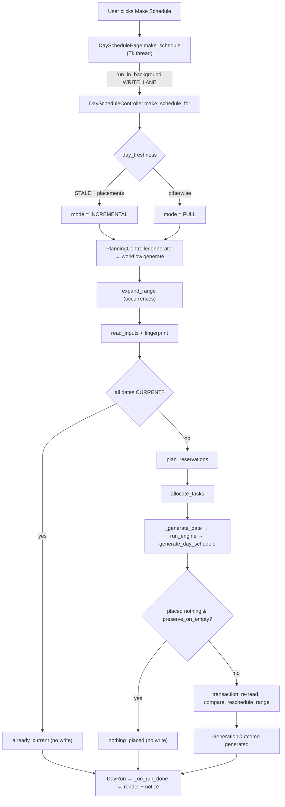
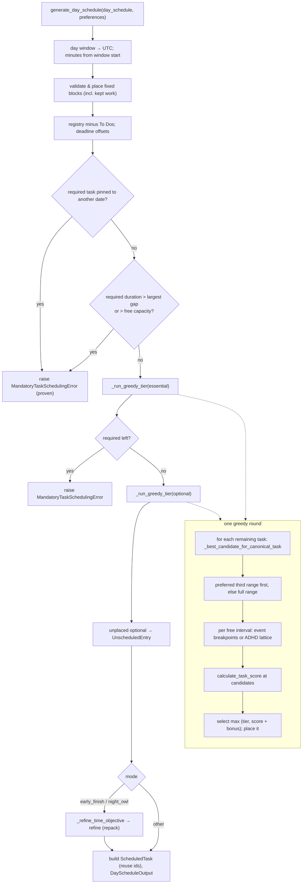
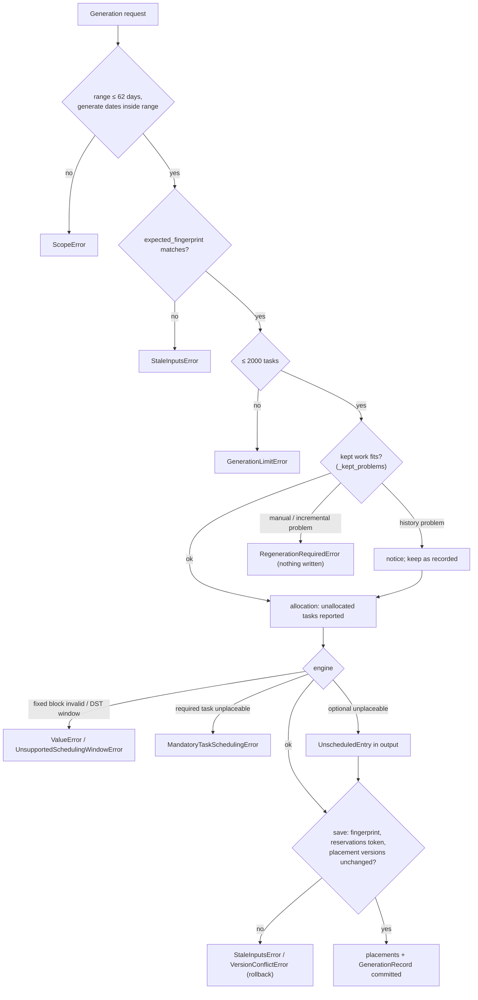
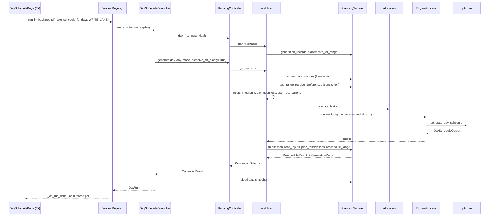

# Workflow

How Schedule Maxing behaves at run time: which functions execute, in what order, how the scheduling engine
decides, and which rules constrain it. Structure (where code lives, module dependencies, feature-to-file
map) is in [ARCHITECTURE.md](ARCHITECTURE.md); mode formulas are also described in
`docs/scheduling-modes.md`, rescheduling and kept work in `docs/execution-rescheduling.md`, recurrence in
`docs/recurrence.md`, sync in `docs/sync-protocol.md`.

Verified against commit `abd5da7` on 2026-10-27 by reading the source. The source is authoritative; where a
docstring disagrees with code, the code's behaviour is described and the discrepancy noted. Worked examples
are hand-computed from the code and labelled **(example)**; they are not recorded executions.

## Contents

1. [Main workflow overview](#1-main-workflow-overview)
2. [Complete end-to-end execution flow (Make Schedule)](#2-complete-end-to-end-execution-flow-make-schedule)
3. [Engine internal workflow](#3-engine-internal-workflow)
4. [Business rules and constraints](#4-business-rules-and-constraints)
5. [Decision logic and priorities](#5-decision-logic-and-priorities)
6. [Workflow diagrams](#6-workflow-diagrams)
7. [Data transformations](#7-data-transformations)
8. [Error handling and edge cases](#8-error-handling-and-edge-cases)
9. [End-to-end worked example](#9-end-to-end-worked-example)
10. [Function call trace](#10-function-call-trace)
11. [Testing and verification](#11-testing-and-verification)

---

## 1. Main workflow overview

The primary functionality is **schedule generation** ("Make Schedule"): turn persisted tasks, fixed blocks
and preferences into saved minute-precise placements for one or more dates. Secondary workflows record what
happened and derive analytics from it.

| Workflow | Trigger | Starts at | Input | Processed by | Result goes to |
|---|---|---|---|---|---|
| **A. Make Schedule (Day page)** | "Make Schedule" / "Regenerate" button | `DaySchedulePage.make_schedule` / `regenerate` (`app/ui/day_page.py`) | The page's anchor date; stored tasks, blocks, preferences, placements, executions | `DayScheduleController` → `PlanningController.generate` → `workflow.generate` → `allocate_tasks` → `generate_selected_day` → `generate_day_schedule` | SQLite (`scheduled_tasks`, `schedule_generations`), Day page timeline and notice |
| B. Range scheduling (Week/Month, CLI) | Week/Month page action; `python -m app.main --select-date` | `PlanningController.schedule_range` / `generate_day` | Date range | `workflow.expand_range` → `read_inputs` → `allocate` → `generate_from` | SQLite; page / stdout / export files |
| C. Hosted / local web generation | `POST /planning/generate` | `backend/planning_api.py: generate` | `GenerateIn` JSON (range, scope, timezone, mode, expected fingerprint) | `workflow.generate` with a time-limit deadline | PostgreSQL (hosted) or SQLite (local profile); `GenerateOut` JSON |
| D. Explicit reschedule (move) | Moving a timeline item; `POST /planning/placements/{id}/reschedule` | `PlanningController.reschedule_placement` → `workflow.reschedule_placement` | Placement id + version, destination interval | `reschedule_problems` → `PlanningService.apply_reschedule` | Storage (old placement tombstoned `RESCHEDULED`, replacement inserted) |
| E. Execution tracking | Day board actions (start, pause, complete, skip, reopen, outcome columns) | `ExecutionController` (`app/ui/execution_controller.py`) | Placement / fixed block / task + action | `ExecutionService` applying `lifecycle.TRANSITIONS` | `executions`, `work_sessions` |
| F. Analytics | Showing Productivity / Week / Month | `ProductivityController` | Executions + schedule history | `ProductivityService` → `tracker.py`, `schedule_cohort.py`, `day_summary.py` | Rendered pages (nothing stored) |
| G. Synchronization | Background thread interval, commit listener, "Sync now" | `SyncService.sync_now` (`app/sync/service.py`) | Dirty records, server change feed | `SyncEngine.prepare/next_batch/acknowledge/apply_pull_page` | Server via `/sync/push`; local apply of `/changes` |

Background execution contexts on the desktop: `WorkerRegistry` threads (all storage/computation off the Tk
thread; writes serialized on `WRITE_LANE`), one spawned `EngineProcess` worker for day-engine calls (when
`SCHEDULE_MAXING_GENERATION_PROCESS` is not `off`), the `SyncService` daemon thread, and main-thread timers
(status poll, GC). The server has one background job: the email `OutboxWorker`.

The rest of this document traces workflow **A** in full, because B and C share the same functions from
`workflow.read_inputs` onward.

---

## 2. Complete end-to-end execution flow (Make Schedule)

### Step 1 — Event reception (Tk thread)

- **Function:** `DaySchedulePage.make_schedule` → `_start_run(self.page_controller.make_schedule_for)`
  (`app/ui/day_page.py`). `regenerate` first asks for confirmation, then uses `regenerate_for`.
- **Input:** the page's `anchor_date` captured now (a later navigation does not change the run's date).
- **Processing:** refuses while busy (`_refuse_while_busy`), sets the busy state, submits
  `operation(day)` with `run_in_background(..., serial=WRITE_LANE)` (`app/ui/background.py`).
- **Output / next:** a job in `WorkerRegistry`; the Tk thread returns immediately.
- **Failure:** registry shutting down → `run_in_background` returns `False` and the busy state is cleared;
  more than `MAX_QUEUED = 64` queued jobs → the job is not run and `on_done` receives
  `ControllerResult.failure(SATURATED_MESSAGE)`.

### Step 2 — Generation-mode decision (worker thread)

- **Function:** `DayScheduleController.make_schedule_for(day)` (`app/ui/day_controller.py`).
- **Processing:** `PlanningController.day_freshness([day])` → `workflow.day_freshness`. Mode:
  `INCREMENTAL` if the date is `STALE` **and** has saved placements, else `FULL`. `regenerate_for` always uses
  `FULL`.
- **Next:** `_run(day, mode)` → `PlanningController.generate(day, day, generate_start=day,
  generate_end=day, mode=mode, preserve_on_empty=True)`.

### Step 3 — Controller wrapper

- **Function:** `PlanningController.generate` → `_generation_call(op, ...)` (`app/ui/planning_controller.py`).
- **Processing:** holds the controller's `RLock`; calls `workflow.generate(service, range_start=day,
  range_end=day, generate_start=day, generate_end=day, scope=RangeScope.PLANNED,
  timezone_name=self._timezone, mode=mode, template=self._yaml_overrides, preserve_on_empty=True)`.
  `_yaml_overrides` is the reward template loaded once from `config/task_preference.yaml` at construction.
- **Failure mapping:** `MandatoryTaskSchedulingError` → failure with per-task reasons; any `PlanningError`
  → failure with its message; any other exception → `"Unexpected error: …"`. All are returned as
  `ControllerResult`, never raised.

### Step 4 — Range validation and recurrence expansion

- **Functions:** `workflow.check_range` (`end >= start`, ≤ `MAX_RANGE_DAYS = 62`, else `ScopeError`);
  check `range_start <= generate_start <= generate_end <= range_end`; `workflow.expand_range` →
  `series.expand_occurrences`.
- **Processing:** in its own transaction, materializes concrete occurrence `Task`s for every configured
  series in the range (idempotent; bounded by `MAX_EXPANSION_DAYS` and `MAX_EXPANSION_OCCURRENCES`).
- **Output:** `ExpansionResult` (created occurrences, problems, warnings). This write is committed even if
  the generation later fails.

### Step 5 — Input snapshot and fingerprint

- **Function:** `workflow.read_inputs` (one `service.transaction()`).
- **Processing:**
  1. `PlanningService.load_range(start, end, scope=PLANNED, timezone_name)` → `PlanningRange`. `PLANNED`
     selects tasks whose planned date (`required_date`, else earliest `preferred_dates`) is in the range,
     plus undated tasks eligible for it (deadline local date ≥ range start, or no deadline). Series
     definitions are split off (`planning_range.series`) and never scheduled.
  2. `PlanningService.resolve_preferences(dates, tz, template)` → `DayPreferences` per date (defaults →
     YAML template → stored user layer → stored date layer).
  3. If any date's mode is `CATCH_UP`: `catch_up.catch_up_evidence(service, now)` (one bulk history read
     over the 90 days before the current UTC midnight).
  4. `provenance.inputs_fingerprint(...)` over range, scope, timezone, task content (series included), the
     range's fixed blocks and resolved preferences; when Catch-Up evidence exists the fingerprint is
     re-hashed with `catch_up:{evidence.digest}`.
- **Output:** `SchedulingInputs`.
- **Failures:** invalid timezone (`validate_timezone`), storage errors.

### Step 6 — Request-level checks

- `expected_fingerprint` given and different → `StaleInputsError` (used by the web API's
  preview-then-generate flow; the desktop passes none).
- More than `MAX_GENERATION_TASKS = 2000` tasks → `GenerationLimitError`.

### Step 7 — Freshness short-circuit

- **Function:** `workflow.day_freshness(service, dates, tz, template)`.
- **Processing:** for each date, loads its `GenerationRecord` and saved placements; recomputes the
  fingerprint of the record's own range (once per distinct range) and `placements_digest`;
  `provenance.classify_generation` → `CURRENT`, `STALE` (`NO_PROVENANCE`, `INPUTS_CHANGED`,
  `PLACEMENTS_CHANGED`) or `NONE`.
- **Decision:** every requested date `CURRENT` → return `GenerationOutcome(status="already_current")` with
  stored outputs; **nothing is written** (no ids, versions, timestamps or sync changes).

### Step 8 — Reservations (what is kept)

- **Function:** `workflow.plan_reservations(service, inputs, dates, mode=mode)`.
- **Processing per date:** loads saved placements, their execution statuses and manual intent
  (`preserved_placement_ids`). A placement is kept as:
  - `KEPT_HISTORY` if its execution status is in `HISTORY_PROTECTED_STATUSES`
    (`in_progress`, `paused`, `completed`, `skipped`, `cancelled`);
  - else `KEPT_MANUAL` if it carries manual intent;
  - else `KEPT_EXISTING` when the mode is `INCREMENTAL`.
  Kept placements are validated with `_kept_problems` (window, fixed-block overlap, mutual overlap; for
  non-history also task deleted, out of range, required date, duration, deadline, ADHD grid). History
  problems become non-blocking `notices`; others are `blocking`.
  Outside the generated dates, `_placements_elsewhere` finds live placements of the range's (non-series)
  tasks; those tasks will not be placed again.
  A SHA-256 `token` digests every placement id/version/date/status/manual flag read.
- **Output:** `Reservations`.

### Step 9 — Allocation

- **Function:** `workflow.allocate(inputs)` → `allocation.allocate_tasks(...)`.
- **Processing:** see §3.1. For the Day page the range is the single date, so allocation reduces to a
  capacity and date-constraint check for that date.
- **Output:** `AllocationResult` (`assignments` in allocation order, `unallocated` with reason codes,
  `capacity_remaining`). Unallocated tasks — even required ones — are **reported, not raised**.

### Step 10 — Per-date generation

- **Function:** `workflow.generate_from` → for each date `_check_deadline(deadline)` then `_generate_date`.
- **Blocking problems first:** `reservations.blocking` non-empty → `RegenerationRequiredError(problems)`
  before any engine run.
- **`_generate_date` processing:**
  1. `_busy_blocks(kept, blocks, preferences, day)`: each kept placement becomes engine-only
     `FixedBlock`(s) labelled `"(kept work)"`, clipped to the day window and minus real fixed blocks and
     earlier reservations (deterministic `uuid5` ids; never stored).
  2. `sub_allocation`: allocation assignments minus `excluded_task_ids` (tasks kept on a generated date or
     live elsewhere).
  3. `previous` (FULL only): a `DayScheduleOutput` of the date's replaceable placements, so an identical
     placement keeps its id.
  4. `_catch_up_bonuses`: per-task bonuses and explanations (Catch-Up dates only).
  5. `run_engine(generate_selected_day, sub_allocation, day, tasks, {day: preferences}, {day: [*blocks,
     *busy]}, previous_result=previous, task_bonuses=bonuses)` — executed in the `EngineProcess` when
     installed, else inline (`app/planning/engine_process.py`).
  6. Catch-Up explanations added to each new placement's `optimization_metadata["catch_up"]`.
  7. Result = kept placements + generated placements, `unscheduled` from the engine.
- **`generate_selected_day`** (`app/planning/service.py`): builds `DaySchedule(task_ids = tasks assigned to
  the date, in allocation order)` and calls `generate_day_schedule` exactly once (§3.2).
- **Failure:** `MandatoryTaskSchedulingError` gets `failed_date` attached and propagates; nothing saved.

### Step 11 — Snapshot attachment and empty-result guard

- `_with_category_snapshots`: a placement the engine kept (same id) keeps its stored planning snapshot,
  origin and manual flag; a new one takes its task's snapshot (category, name, tags, points, estimate,
  type) and `origin = GENERATED`.
- `preserve_on_empty` and the dates had saved placements and the run placed nothing at all → return
  `status="nothing_placed"`; **nothing written**.

### Step 12 — Atomic save with re-validation

- `_check_deadline` (last chance before the save).
- Builds `GenerationProvenance` (allocation id, range, scope, fingerprint, timezone, per-date engine mode,
  `generated_at`).
- In **one transaction**:
  1. `read_inputs` again → fingerprint differs → `StaleInputsError`.
  2. `plan_reservations` again → token differs → `StaleInputsError` ("Saved placements, manual placements or
     execution states … changed").
  3. `PlanningService.reschedule_range(start, end, outputs, expected_versions, provenance)`:
     - `_replace_range`: validates ids/dates/task references; compares the range's live placements with
       `expected_versions` (`VersionConflictError` on any difference); tombstones removed placements with
       `removal_reason=REGENERATED` and `superseded_by_id` when the same occurrence is placed again;
       cancels each removed placement's never-started execution (`CancelReason.SUPERSEDED`); inserts new
       placements (owner = task owner); updates changed kept ones (`version + 1`).
     - One `GenerationRecord` per date (insert or compare-and-update), with `placements_digest` of the
       committed placements, counts and `total_score`.
  SQLite triggers record `sync_dirty` rows in the same transaction.
- **Output:** `GenerationOutcome(status="generated", …, reschedule=RescheduleResult,
  evaluations=evaluate_outputs(...))`. `evaluate_outputs` recomputes each date's objective with
  `optimizer.evaluate_day_output` for reporting only.

### Step 13 — Presentation

- **Worker:** `DayScheduleController._run` builds reasons (`_reasons`: "Not allocated to this date: …" and
  "Could not be placed: …", required first), remembers explanations per generation record, reloads the
  date (`_snapshot_for`) and returns a `DayRun` (`generated`, `already_current`, `nothing_placed`,
  `needs_regeneration`, `failed`) with a message, e.g. "Scheduled N task(s)…" or "Kept N … and added M".
  For Early Finish, Night Owl and Catch-Up a `mode_summary` line is appended.
- **Tk thread:** `DaySchedulePage._on_run_done` clears busy, re-renders the snapshot (or reloads if the
  user navigated away) and shows the notice.

---

## 3. Engine internal workflow

### 3.1 Allocation (task → date) — `app/planning/allocation.py: allocate_tasks`

Initialization: every date's fixed blocks are checked for overlap (`ValueError`); capacity per date =
day-window minutes − fixed-block minutes.

1. Split task ids into required and optional; order each tier with `_allocation_order`:
   `(-points, deadline or +∞, -estimated_duration_minutes, str(id))`.
2. For each task (required tier first): `_feasible_dates_for_task`:
   - `required_date` set → only that date (if in range);
   - else `deadline` set → dates where `_deadline_allows` (deadline's local date ≥ date **and**
     window start + duration ≤ deadline; on an ambiguous/nonexistent window start only the date rule);
   - else every date;
   - then keep dates whose remaining capacity ≥ duration.
3. No feasible date → `UnallocatedEntry` with reason (checked in this order): `REQUIRED_DATE_CONFLICT`
   (required date outside range, proven), `DEADLINE_INFEASIBLE` (no date allows the deadline, proven),
   `CAPACITY_EXCEEDED` (candidates existed but none had capacity), else `NO_FEASIBLE_DATE`.
4. Otherwise pick the best of `_rank_candidate_dates`: preferred date first → higher category multiplier on
   that date → more remaining capacity → earliest date. Subtract the duration from that date's capacity.

Allocation never produces minute-level placements and never calls the day engine (spy-tested).

### 3.2 Day engine — `app/optimizer.py: generate_day_schedule`

**Inputs:** `DaySchedule` (date, timezone, fixed blocks including reserved kept work, ordered `task_ids`,
registry), `DayPreferences`, optional `previous_result`, optional `task_bonuses`.

**Initialization and transformation:**

1. Date and timezone of schedule and preferences must match (`ValueError`).
2. `preferences.to_local_day_window().to_utc_instants()` → `[day_start_utc, day_end_utc)`; raises on DST
   offset change inside the window or an ambiguous/nonexistent endpoint.
3. All coordinates become **integer minutes relative to the window start** (`_to_offset`; sub-minute
   instants raise `ValueError`). `day_total_minutes` = window length.
4. `_validate_and_place_canonical_fixed_blocks`: each block must have `end > start` and lie inside
   `[0, day_total]`; sorted blocks must not overlap → list of `_Placed(fixed=True, category="fixed")`.
5. Registry = scheduled task ids minus To Dos (`is_todo`), which are never placed nor reported.
6. `settings = day_preferences_to_reward_settings(preferences)`; `mode = preferences.optimizer_mode`;
   `deadline_offsets` for tasks with a deadline.
7. `required_date` ≠ this date: required → collected as `REQUIRED_DATE_CONFLICT` failures (raised
   together, proven infeasible); optional → silently excluded.
8. Tiers: `essential_ids` (required) and `optional_ids`, both keeping input order.
9. Proven-infeasibility checks for required tasks (raise immediately): duration > largest free interval;
   total required duration > total free capacity.

**Greedy placement (`_run_greedy_tier`, run for essential then optional):**

```text
remaining = tier task ids (input order)
while remaining:
    best = None
    for task in remaining:
        cand = _best_candidate_for_canonical_task(task, placed, ...)   # (start, end, score) or None
        if cand is None: continue
        tier = 1 if task.preferred_time is None
               else 2 if cand.start inside the task's preferred third else 0
        key  = (tier, cand.score + catch_up_bonus(task))               # bonus only in Catch-Up
        if key > best.key: best = (task, cand, key)                    # strict: first task wins ties
    if best is None: break                                            # nothing else fits
    placed.append(_Placed(best.cand ...)); results[task] = cand; remaining.remove(task)
return results, remaining
```

- Required tasks left in `remaining` → `MandatoryTaskSchedulingError` (`proven_infeasible=False`); reason
  `WINDOW_UNSUPPORTED` if the task has a deadline (explanation "no valid slot … before this task's
  deadline"), else `NO_VALID_SLOT`.
- Optional tasks left → `UnscheduledEntry` with the same reason mapping.
- Each re-evaluation sees all placements made so far; candidates are recomputed for every remaining task on
  every round (O(tasks²) candidate searches per tier).

**Candidate search for one task (`_best_candidate_for_canonical_task`):**

1. `_prepare_canonical_task_search`: `first_start = 0`, `latest_start = day_total − duration`, reduced to
   `deadline_offset − duration` when there is a deadline; empty range → `None`.
   `_canonical_scoring_task`: preferred window = the task's preferred third
   (`preferred_third_bounds(preferred_time, 0, day_total)`) if set, else the legacy
   `preferred_time_window`, else the date's category window (converted to day-relative minutes by
   `_normalize_preferred_window`), else none. `tag` = first tag.
2. `_preferred_tier_first`: search only the start range that keeps the task inside its third
   (`_preferred_start_range`: `[lo, max(lo, hi − duration)]`); search the full range only if that yields
   nothing.
3. `search(first, latest)` walks free intervals between placed items in chronological order; for each,
   `_best_start_in_free_interval` with `previous_item`/`next_item` = the placed items bounding that gap.
   Keeps the strictly better score → earliest interval wins ties.

**`_best_start_in_free_interval`** clips to `[max(first, gap_start), min(latest, gap_end − duration)]`.

- *ADHD lattice* (mode `adhd_friendly` and duration > 30): candidates are the local quarter-hour starts in
  the range (`_lattice_points`, anchored at the window's local start minute); each is scored; earliest
  maximum wins (`_earliest_best_among`).
- *Unrestricted minute search* (all other cases): `_event_breakpoints` derives the cut points where any
  reward component can change slope or step — preferred start, `preferred_end − duration`, the centre,
  centre ± `max_time_distance_minutes`; for each real neighbour the gap = 0, gap = `min_gap`, gap =
  `same_tag_window`; and, in ADHD with a short task, the short-gap "active zones". Between consecutive cuts
  the score is affine, so `_earliest_best_in_continuous_range` finds the earliest maximum with a binary
  search on the rounded score; ranges overlapping an active zone are scanned minute by minute.
- `_best_candidate_for_canonical_task_exhaustive` scores every candidate minute; it is a test/benchmark
  oracle only.

**Scoring (`app/reward.py: calculate_task_score`)** — rounded to 2 decimals:

```text
score = W_imp * category_weight(category)                      # weight (constant per task)
      + time(start)                                            # W_time if inside window, else
                                                               #   W_time * max(0, 1 - |centre - window_centre| / max_dist)
      + Σ_neighbours relation                                  # gap <= same_tag_window: W_tag (same/related tag)
                                                               #   or W_tag/2 (same category)
      + Σ_neighbours fragmentation                             # W_frag if 0 < gap < min_gap
      + short_gap_bonus                                        # ADHD only, duration <= max_minutes:
                                                               #   per side W_sg*(1 - pre_gap/min_gap) if 0<=pre_gap<min_gap,
                                                               #   day edges count as neighbours; capped at cap
```

Defaults (`RewardSettings`, matching `config/task_preference.yaml`): `W_imp = 5`, `W_time = 3`,
`W_tag = 2`, `W_frag = −4`, `max_dist = 240`, `same_tag_window = 120`, `min_gap = 30`, short-gap weight 0
(disabled), max 20 min, cap 10. `weight_category_bonus` is read by no component. A task's `points` are
never scored.

**Mode-specific post-processing:**

- **Normal (`precise_greedy`)**: baseline as above.
- **ADHD (`adhd_friendly`)**: quarter-hour lattice for tasks > 30 min; short-gap bonus active
  (`adhd_mode=True`) when configured.
- **Catch-Up (`catch_up`)**: `task_bonuses` added to the selection key only; stored score = insertion score.
- **Early Finish / Night Owl**: after both tiers, `_refine_time_objective` → `mode_objectives.refine`
  (§3.3). Stored scores become each placement's *final* baseline reward over its actual neighbours.

**Result construction:** `previous_result` placements with the same `(task_id, planned_start,
planned_end)` keep their id; all others get `uuid4()`. Offsets convert back to UTC (`_from_offset`). The
output registry holds only placed and unscheduled tasks; `total_score = round(Σ score, 2)`.

**Completion:** the engine ends when both tiers have no placeable task left; there is no iteration limit
or timeout inside the engine (the workflow's `deadline` is checked only between dates and before saving).

### 3.3 Early Finish / Night Owl refinement — `app/mode_objectives.py`

Objective: `B(S) + time_bonus`, where `B(S)` is the sum of final baseline rewards
(`optimizer._final_scores`, scored with `adhd_mode=False` against actual chronological neighbours).

```text
For a nonempty schedule (day-relative minutes, A = 0, Z = day_total, H = max(1, Z)):
  F = first flexible start, L = last flexible finish, N = count
  G = unoccupied minutes in [F, L] (fixed blocks and kept work count as occupied)
  E = (Z-L)/H   T = F/H   C = 1 - G/H   U = mean(start_i)/H     (each clamped to [0,1])
  W = max(1, |weight_importance|)
  Early Finish bonus = W * N * (0.50*E + 0.35*C + 0.15*(1-U))
  Night Owl   bonus = W * N * (0.50*T + 0.35*C + 0.15*U)
```

`refine`: evaluate the baseline first; then candidate orders from `_orders` — the baseline's chronological
order plus every permutation of the input-ranked order when there are ≤ 6 tasks, else just chronological and
ranked. Each order is packed around fixed intervals by `_pack` (left/first-fit for Early, right/last-fit in
reverse order for Night), honouring each task's `[earliest, latest_finish]` (deadline; a task placed inside
its preferred third is confined to that third). Orders that do not fit are skipped. Selection key:
`(-round(objective, 9), L, G, index)` for Early, `(-round(objective, 9), -F, G, index)` for Night; the
baseline is index 0 and always competes, so the result is never worse than the baseline.

### 3.4 Catch-Up evidence — `app/planning/catch_up.py`

- `summarize`: for placements planned in `[as_of − 90 days, as_of)` with a live execution whose status is
  `COMPLETED` or `SKIPPED`, group by occurrence key and keep the latest outcome per occurrence. Category =
  execution snapshot, else placement snapshot; unknown categories contribute nothing.
- `CatchUpEvidence.bonus(category, W)`: `n = misses + completions`; `n < 5` → 0 ("insufficient history");
  else `p = (m + 1)/(n + 4)`, `reliability = n/(n + 5)`, `bonus = clamp(W * reliability * p, 0, W)`.

### 3.5 How the mode is selected

`DayPreferences.optimizer_mode`, resolved by layer precedence: built-in default `precise_greedy` → YAML
template (carries none by default) → stored user layer (`PlanningController.set_engine_mode`, CLI `--mode`)
→ stored date layer (Day page preferences). Each date of a range can use a different mode.

---

## 4. Business rules and constraints

### 4.1 Hard constraints (engine; never converted into penalties)

| Constraint | Definition | Implementation | When checked | Failure behaviour | Exceptions |
|---|---|---|---|---|---|
| Day window | Placements and fixed blocks lie in `[window start, window end)` | `optimizer._validate_and_place_canonical_fixed_blocks`; search bounded to `[0, day_total − duration]` | Engine start / candidate generation | Block outside → `ValueError`; task simply has no candidate | — |
| Supported window | Window ends same day or next midnight; no DST offset change; endpoints unambiguous | `time.LocalDayWindow.__post_init__`, `to_utc_instants` | Engine start; preference model validation | `UnsupportedSchedulingWindowError` / `AmbiguousLocalTimeError` | Allocation and fixed-block rules use `endpoint_instants` (DST-spanning windows allowed there) |
| Minute precision | Fixed-block and deadline instants are whole minutes relative to the window | `optimizer._to_offset` | Engine start | `ValueError` (never rounded) | — |
| No overlap | Placements never overlap each other, fixed blocks or kept work | Search only inside free intervals between `_Placed` items | Every candidate search | Task gets no candidate there | Kept history may overlap a later block; only its free part is reserved |
| Fixed blocks don't overlap | Sorted blocks are disjoint | `_validate_and_place_canonical_fixed_blocks`; `allocation._validate_fixed_blocks_no_overlap` | Engine / allocation start | `ValueError` | — |
| Duration | Placement length = `estimated_duration_minutes` (never split or rounded) | Engine uses exact duration; `Task` field `gt=0` | Always | — | To Dos are excluded from placement |
| Deadline | `end ≤ deadline` | `latest_start = deadline_offset − duration` | Candidate search | No candidate → unscheduled (`WINDOW_UNSUPPORTED`) or required failure | — |
| Required date | Task pinned to its `required_date` | Engine loop over registry; allocation `_feasible_dates_for_task` | Engine start; allocation | Required: `MandatoryTaskSchedulingError(REQUIRED_DATE_CONFLICT)`; optional: excluded | — |
| Required work | Every required task on the date placed exactly once | Essential tier + capacity checks | Engine | `MandatoryTaskSchedulingError` with per-task reasons; nothing saved | Required tasks *unallocated* to the date are only reported |
| ADHD grid | In ADHD mode, tasks > 30 min start on local quarter hours | `_candidate_starts` / lattice; `_kept_problems` for kept work | Candidate search; kept-work check | No lattice candidate → unscheduled; kept → `engine_mode_changed` problem | Tasks ≤ 30 min use any minute |
| History protection | Placements whose execution started or finished are never moved or replaced | `plan_reservations` (`KEPT_HISTORY`), `reschedule_source` (`HistoryProtectedError`) | Generation; move | Kept as recorded; problems are notices | — |
| Manual intent | Manually moved placements (`preserved`) stay until released | `plan_reservations` (`KEPT_MANUAL`) | Generation | If it no longer fits → `RegenerationRequiredError` | Released via `release_manual_placement` |
| Occurrence uniqueness | One live placement per occurrence; no re-placement of work live elsewhere | `_placements_elsewhere`, `excluded_task_ids`, `reschedule_problems` (`occurrence_taken`) | Generation; move | Reported in `kept_elsewhere`; move rejected | — |

### 4.2 Soft constraints (reward; rank valid placements)

| Rule | Effect | Implementation |
|---|---|---|
| Category weight | `W_imp × multiplier` per task; drives greedy order between tasks | `reward._weight_score`; multipliers from preference layers |
| Preferred window / third | Full `W_time` inside; linear decay with centre distance outside | `reward._time_score`; window from `_canonical_scoring_task` |
| Preferred third tier | Placements inside the third are chosen first and searched first | `_preferred_tier_first`, tier in `_run_greedy_tier`, repack confinement | 
| Tag / category relation | Bonus for related neighbours within `same_tag_window` | `reward._relation_score` |
| Fragmentation | Penalty per neighbour leaving `0 < gap < min_gap` | `reward._fragmentation_score` |
| ADHD short-gap | Bonus for short tasks filling stranded gaps (disabled by default) | `reward._short_gap_bonus_score` |
| Mode bonuses | Early/Night compactness and timing; Catch-Up category bonus | `mode_objectives.time_bonus`, `catch_up` |

### 4.3 Allocation rules (business rules, coarse)

Required tier before optional; order by points, deadline, duration, id; per-date capacity; required date;
deadline judged in the date's own timezone; date ranking by preferred date, category multiplier, remaining
capacity, earliest date. Failures are reported in `AllocationResult.unallocated`, never raised.

### 4.4 Validation rules (input acceptance)

| Rule | Implementation | Failure |
|---|---|---|
| Task: non-empty name/category, duration > 0, points 0..1000, aware deadline, To Do cannot repeat, recurrence identity invariants | `app/planning/models.py: Task` validators | `ValidationError` |
| Fixed block / placement: `planned_end > planned_start`, aware instants, valid timezone | `FixedBlock`, `ScheduledTask` validators | `ValidationError` |
| `DayScheduleOutput`: placements reference known tasks; a task not both placed and unscheduled; `total_score` equals the sum | `DayScheduleOutput._validate_consistency` | `ValidationError` |
| Reward settings finite; `max_time_distance_minutes > 0`; short-gap values valid | `RewardSettings.__post_init__`, `RewardPreferences` validators | `ValueError` |
| YAML ≤ 256 KiB and a mapping at top level | `reward.load_reward_settings` | `ValueError` |
| Fixed-block writes: valid interval, whole minutes, starts on its date in its timezone, inside the effective day window, no overlap with same-owner blocks (± 1 day) | `fixed_block_rules.check_interval`, `check_no_overlap` via `PlanningService._check_fixed_block` and `backend/resources.py` | `FixedBlockRuleViolation` (codes `invalid_interval`, `sub_minute_precision`, `date_mismatch`, `outside_day_window`, `unsupported_day_window`, `overlap`) |
| Optimistic concurrency on every update/delete | `PlanningService._check_version`, repository compare-and-update; server `Mutator` | `VersionConflictError` / HTTP 409 |
| Range limits: ≤ 62 days, ≤ 2000 tasks | `workflow.check_range`, `generate` | `ScopeError`, `GenerationLimitError` |
| Legacy CSV fully validated before writing; overlapping fixed blocks in the file refused | `csv_import.py` | `CsvImportError` with line numbers |
| Reschedule destination: starts on its date, whole minutes, actually moved, required date, deadline, window, no overlap, exact duration, ADHD grid, occurrence rules | `workflow.reschedule_problems` | `RescheduleRejectedError` listing all problems |

### 4.5 State transition rules (execution lifecycle)

`app/execution/lifecycle.py: TRANSITIONS` — the only definition:

| Action | From | To |
|---|---|---|
| start | scheduled | in_progress |
| pause | in_progress | paused |
| resume | paused | in_progress |
| complete | scheduled, in_progress, paused | completed |
| skip | scheduled, in_progress, paused | skipped |
| cancel | scheduled, in_progress, paused | cancelled |
| reopen | completed, skipped | paused if work sessions exist, else scheduled (`reopen_target`) |

`complete` from `scheduled` records only `actual_final_end_at` (metrics stay unknown, never 0); otherwise it
closes the open session and computes active duration, variance and start delay. Nothing leaves `cancelled`.
A regeneration cancels a replaced placement's never-started execution with `CancelReason.SUPERSEDED`.

### 4.6 Data-integrity and security rules (selected)

- Soft deletion only; tombstoned ids can never be reused by a create (`DuplicateEntityError`).
- Ownership: records belong to a workspace (`user_id`); `PlanningService.scoped(owner)` restricts reads and
  writes; on the server identity comes only from `api.current_user_id` (bearer token or browser session +
  CSRF).
- One process per local database (`instance_lock.acquire_instance_lock`, `DatabaseInUseError`).
- Local schema newer than the code → refused (`NewerSchemaError`); backup before every migration.
- Server writes serialized per user (`Mutator`, `users.change_seq` lock); idempotent sync by `op_id`.

---

## 5. Decision logic and priorities

**Generation mode (Day page):** `regenerate` → FULL; `make_schedule` → INCREMENTAL if `STALE` with
placements, else FULL. Web/CLI callers choose explicitly (default FULL).

**Workflow early exits, in evaluation order:** range invalid → `ScopeError`; fingerprint mismatch with
`expected_fingerprint` → `StaleInputsError`; > 2000 tasks → `GenerationLimitError`; all dates `CURRENT` →
`already_current`; blocking kept-work problem → `RegenerationRequiredError`; deadline passed between dates
→ `GenerationLimitError`; engine required failure → `MandatoryTaskSchedulingError`; `preserve_on_empty` and
nothing placed → `nothing_placed`; deadline passed before save → `GenerationLimitError`; inputs or
reservations changed → `StaleInputsError`; version mismatch in `_replace_range` → `VersionConflictError`.

**Kept-work precedence per placement:** history > manual > incremental-existing > replaceable.

**Freshness classification order (`classify_generation`):** no record → `NO_PROVENANCE` if placements exist
(else `NONE`); fingerprint version or fingerprint differs → `INPUTS_CHANGED`; placements digest differs →
`PLACEMENTS_CHANGED`; else current. A recorded range whose inputs can no longer be recomputed counts as
`INPUTS_CHANGED`.

**Engine precedence and tie-breaking:**

1. Validation failures and proven infeasibility before any search.
2. Required tier fully before optional tier.
3. Within a tier, per round: tier class (inside preferred third = 2 > no preference = 1 > preference
   unmet = 0), then score (+ Catch-Up bonus), then input order (first wins).
4. Within a task: preferred-third range before the full range; earliest free interval among equal scores;
   earliest minute among equal scores within an interval.
5. Input order = allocation order (points ↓, deadline ↑, duration ↓, id) for allocated tasks.

**Thresholds:** ADHD short task ≤ 30 min; quarter hour 15; exhaustive repack ≤ 6 tasks; Catch-Up lookback 90
days and ≥ 5 outcomes; range 62 days; 2000 tasks; YAML 256 KiB; reward defaults in §3.2.

**Fallbacks:** preferred third full → full-day search; Early/Night repack never worse than baseline;
engine process failure → in-thread call for the rest of the session (`EngineProcess.__call__`); an engine
*domain* error raised in the worker is re-raised by running the same call locally (`_is_engine_error`);
missing YAML → `RewardSettings` defaults; missing category multiplier → 1.0; no Catch-Up history → Normal
behaviour.

**Unavailable data:** unknown snapshot category → no Catch-Up evidence; unscheduled explanations after
restart are unknown (only the count is stored) and never fabricated; tasks deleted after being kept are
loaded with `get_tasks_including_deleted`.

---

## 6. Workflow diagrams

### A. High-level execution flow



### B. Detailed engine flow



### C. Constraint validation flow



### D. Sequence diagram



---

## 7. Data transformations

| Stage | Input | Output / intermediate | Notes |
|---|---|---|---|
| Storage → snapshot | SQLite rows | `PlanningRange` (`TaskRegistry`, `fixed_blocks_by_date`, `placements_by_date`, `series`) | `PlanningRepository` row mapping |
| Preference layers → day prefs | `PreferenceOverrides` (template), `PreferenceRecord` (user/date) | `DayPreferences` | `resolve_day_preferences` (absent = inherit, `None` in a dict = clear) |
| Snapshot → fingerprint | Tasks (content minus audit fields), blocks, prefs | SHA-256 hex | `inputs_fingerprint`, `FINGERPRINT_VERSION = 2` |
| Snapshot → allocation | `TaskRegistry`, prefs, blocks | `AllocationResult.assignments: {task_id: date}` | Capacity in minutes |
| Kept placements → busy time | `ScheduledTask` | `FixedBlock(category="reserved", label="(kept work)")` | Engine-only, never stored |
| Engine input | Allocation for a date | `DaySchedule(task_ids=[…])` | `generate_selected_day` |
| UTC → minutes | Aware instants | Integer minute offsets from window start | `_to_offset` |
| Task → scoring view | `Task` + prefs | `ScoringTask(category, duration, tag, preferred_window)` | `_canonical_scoring_task` |
| Prefs → reward settings | `DayPreferences.reward`, multipliers | `RewardSettings` | `day_preferences_to_reward_settings` |
| Engine result | `(start, end, score)` per task | `ScheduledTask`, `UnscheduledEntry`, `DayScheduleOutput` | Ids reused from `previous_result` |
| Pre-save | `DayScheduleOutput` | + planning snapshot, `origin`, Catch-Up metadata | `_with_category_snapshots`, `_generate_date` |
| Save | Outputs, provenance | `scheduled_tasks` rows (insert/update/tombstone), `schedule_generations` row, `sync_dirty` rows | `reschedule_range`, triggers |
| Execution | Placement + action | `TaskExecution` with snapshot (name, category, points), `WorkSession`s | `ExecutionService` |
| Analytics | Executions + `ScheduleHistory` | `TrackerReport`, `ScheduleCohortReport`, day summaries | Computed on every read |
| Sync | `sync_dirty` | `OutboxOp` (wire JSON, stable `op_id`) → server revisions/change log → pulled pages | `SyncEngine`, `Mutator` |

**(example)** a task as stored and as the engine sees it:

```python
Task(id=UUID("…a1"), name="Thesis writing", category="study", tags=["thesis"],
     estimated_duration_minutes=120, points=5, required=True,
     preferred_dates=[date(2026, 11, 2)], preferred_time=PreferredTime.EARLY)
# On a 08:00-18:00 day (600 min), day-relative:
ScoringTask(category="study", duration=120, tag="thesis", preferred_window=(0, 200))
# Engine output for it:
ScheduledTask(task_id=UUID("…a1"), planned_date=date(2026, 11, 2), timezone="Europe/London",
              planned_start=datetime(2026, 11, 2, 8, 0, tzinfo=UTC),
              planned_end=datetime(2026, 11, 2, 10, 0, tzinfo=UTC), score=8.0)
```

---

## 8. Error handling and edge cases

| Situation | Handling | Where |
|---|---|---|
| Required task cannot be placed | `MandatoryTaskSchedulingError` (`failures` with reason, explanation, `proven_infeasible`); nothing saved. Day page: "Required tasks could not all be scheduled…"; API: 422 `generation_failed` | `optimizer`, `DayScheduleController._run_failure`, `planning_api.api_error` |
| Optional task cannot be placed | `UnscheduledEntry`; schedule saved; reason shown | engine; `_reasons` |
| Task not allocated (capacity, deadline, required date) | `UnallocatedEntry`; generation continues; shown as "Not allocated to this date" | `allocation`, `_reasons` |
| Empty request (no tasks) | Engine returns an empty output; saved with a `GenerationRecord` (empty day is "current") unless `preserve_on_empty` and saved placements existed → `nothing_placed` | `generate_from` |
| Kept manual/incremental work no longer fits | `RegenerationRequiredError` with problems and remedies; Day page returns `needs_regeneration`; API 409 `regenerate_required` | `plan_reservations`, `_kept_problems` |
| Kept history no longer fits | Non-blocking notice; history unchanged | `_kept_problems` |
| Inputs changed during generation | `StaleInputsError`; transaction rolled back; API 409 `inputs_changed` | `generate_from` |
| Concurrent placement edit | `VersionConflictError`; rollback | `_replace_range` |
| DST transition inside the day window / ambiguous endpoint | `UnsupportedSchedulingWindowError` / `AmbiguousLocalTimeError` from the engine. API maps to 422 `unsupported_day_window`. **Desktop:** not specially handled; shown through the generic `"Unexpected error: …"` path of `_generation_call` | `time.py`, `planning_api.api_error`, `PlanningController._generation_call` |
| Stored fixed block outside a changed day window | Engine `ValueError` ("outside the day window"); API 422 `generation_failed`; desktop generic message. Fixed-block writes prevent this at write time, but changing preferences later does not re-validate stored blocks | `optimizer`, `fixed_block_rules` docstring |
| Generation too slow | Web API: `GENERATION_TIME_LIMIT_SECONDS` → deadline checked between dates/before save → `GenerationLimitError` (503). Desktop passes no deadline. No timeout inside the engine | `workflow._check_deadline`, `planning_api` |
| Engine process failure | Falls back to in-thread execution permanently for the session; logged | `EngineProcess.__call__` |
| Database in use by another process / newer schema / migration failure | Startup shows "Database Unavailable" panel and error dialog; no scheduler without storage | `ScheduleOptimizerApp.__init__`, `describe_startup_failure` |
| Unexpected exception in a controller | Caught and returned as `ControllerResult.failure("Unexpected error: …")` | `PlanningController._call/_generation_call` |
| Unexpected exception in a Tk callback | Logged and shown once; window keeps working | `logging_setup.tk_error_handler` |
| Network failure during sync | `SyncReport("offline")`; failure counter drives exponential backoff; batch attempts recorded | `SyncService.sync_now` |
| Expired token during sync | One renewal attempt, then `auth_required` | `SyncService.sync_now` |
| Server refuses a push batch as malformed | Batch narrowed unit by unit; refused units become `push_rejected` conflicts | `SyncService._push`, `SyncEngine.refuse` |
| Partial completion | Recurrence expansion commits before generation; a failed generation leaves expanded occurrences (by design: idempotent). All other generation writes are atomic | `expand_range` |
| Greedy suboptimality | Not an error: a different order could place more work; `proven_infeasible=False` marks such failures | engine docstrings |

Cases with **no explicit handling**: the engine has no internal time limit; desktop DST/ValueError cases use
the generic message rather than a dedicated explanation.

---

## 9. End-to-end worked example

**(example)** — inputs and results computed by hand from the code paths above, with default reward
settings and all category multipliers 1.0.

**Initial input** (stored before the run):

- Date `2026-11-02`, planning timezone `Europe/London` (UTC+0 on that date, no DST change).
- Date preference layer: `day_window = DayWindowSpec(start_minute=480, end_minute=1080)` (08:00–18:00);
  mode `precise_greedy` (Normal).
- Fixed block "Lunch" 12:00–13:00.
- Tasks, all with `preferred_dates=[2026-11-02]`:
  - **A** "Thesis writing", study, tag `thesis`, 120 min, **required**, `preferred_time=EARLY`, points 5.
  - **B** "Gym", health, 60 min, optional, no preference, points 3.
  - **C** "Email", work, 20 min, optional, deadline 2026-11-02 10:00, points 1.
- No saved placements for the date.

**1. Trigger and mode.** The user clicks Make Schedule. `day_freshness` → `NONE` (no record, no
placements) → mode `FULL`.

**2. Validation and inputs.** Range 1 day — valid. No series → expansion creates nothing. `load_range`
(scope `PLANNED`) returns A, B, C (planned date 2026-11-02). Preferences resolved; fingerprint computed. Not
current → continue. `plan_reservations` keeps nothing (no saved placements), token over an empty list.

**3. Allocation.** Capacity = 600 − 60 = 540. Required tier: A → assigned (capacity 420). Optional tier
ordered by points: B (3), then C (1). B → assigned (360). C: `_deadline_allows` (deadline on the date; 08:00
+ 20 min ≤ 10:00) → assigned (340). `assignments` order: A, B, C.

**4. Engine setup.** Day-relative minutes: `day_total = 600`; Lunch = `[240, 300)`. Deadline offset of C
= 120. Free intervals `[0, 240)` and `[300, 600)`. Required checks: 120 ≤ largest gap 300; 120 ≤ free
capacity 540.

**5. Essential tier.** A's EARLY third = `[0, 200)` → preferred start range `[0, 80]`. In gap `[0, 240)`
(next neighbour Lunch): weight 5 + time 3 (fully inside) + relation 0 (Lunch has category `fixed`, no tag)
+ fragmentation 0 (gap to Lunch = 120 − start ≥ 40) = **8.0** for every start 0..80. Earliest maximum →
A at `[0, 120)` = 08:00–10:00, tier 2.

**6. Optional tier, round 1.**
- B: gap `[120, 240)` between A and Lunch, starts 120..180. Weight 5, no time window. Fragmentation −4 when
  the gap to A is 1..29 (start 121..149) or to Lunch is 1..29 (start 151..179); starts 120, 150, 180 score
  **5.0**. The earliest interval and minute win → `(120, 180, 5.0)`.
- C: `latest_start = min(600 − 20, 120 − 20) = 100`; the only free time before minute 100 would be before A,
  but A occupies `[0, 120)` → **no candidate**.
- Selected: B (tier 1, 5.0) → 10:00–11:00.

**7. Optional tier, round 2.** C still has no candidate → loop ends. C becomes
`UnscheduledEntry(reason_code=WINDOW_UNSUPPORTED, explanation="no valid slot was found before this task's
deadline given the current schedule.")`. (The greedy order placed required A first in its preferred third;
a non-greedy solver could have fit C at 08:00–08:20 and A at 08:20–10:20 — this engine does not claim
global optimality.)

**8. Output.** Placements A 08:00–10:00 (8.0) and B 10:00–11:00 (5.0); unscheduled C; `total_score = 13.0`.
Mode Normal → no refinement.

**9. Save.** `_with_category_snapshots` copies each task's snapshot (category, name, tags, points,
estimate, type) onto the new placements, `origin = GENERATED`. In the save transaction the fingerprint and
token are unchanged; `reschedule_range` inserts two placements and one `GenerationRecord`
(`placement_count=2`, `unscheduled_count=1`, `total_score=13.0`, `engine_mode=precise_greedy`).

**10. Presentation.** `DayRun("generated", …, "Scheduled 2 task(s). 1 task(s) could not be placed; see the
reasons.")` with reason "Email — Could not be placed: no valid slot was found before this task's deadline
given the current schedule." Reopening the page later shows the date as **Current** until any input changes.

**Variant — Early Finish.** With mode `early_finish` the same greedy baseline is computed first and then
refined. A was placed inside its third, so its `RepackTask` is confined to `earliest = 0`,
`latest_finish = 80 + 120 = 200`; B gets `[0, 600]`. Candidates (`_orders`, input rank A, B):

| Candidate | Starts | B(S) | F, L, G | E, C, U | Bonus `5·2·(0.5E + 0.35C + 0.15(1−U))` | Objective |
|---|---|---|---|---|---|---|
| baseline (index 0) | A 0, B 120 | 8 + 5 = 13 | 0, 180, 0 | 0.7, 1.0, 0.10 | 8.35 | 21.35 |
| chronological [A, B] (1) | A 0, B 120 | 13 | same | same | 8.35 | 21.35 (loses tie on index) |
| [B, A] (2) | B 0, A 60 | 5 + 8 = 13 | 0, 180, 0 | 0.7, 1.0, 0.05 | 8.425 | **21.425** |

`[B, A]` wins: B 08:00–09:00 and A 09:00–11:00 (still inside its third), stored scores B 5.0 and A 8.0
(final baseline rewards), C still unscheduled; the Day page reasons gain a mode summary line.

**Variant — Catch-Up bonus.** If the last 90 days held 4 skips and 2 completions of category `health`:
n = 6, p = 5/10 = 0.5, reliability = 6/11 ≈ 0.545, bonus = 5 × 0.545 × 0.5 ≈ **1.36** added to B's selection
key (B's stored score stays 5.0).

---

## 10. Function call trace

Main path (Day page Make Schedule; desktop, local SQLite):

```text
DaySchedulePage.make_schedule()                                  app/ui/day_page.py
  -> _start_run(page_controller.make_schedule_for)
     -> run_in_background(work, on_done, serial=WRITE_LANE)     app/ui/background.py
        [worker thread]
        -> DayScheduleController.make_schedule_for(day)          app/ui/day_controller.py
           -> PlanningController.day_freshness([day])            app/ui/planning_controller.py
              -> workflow.day_freshness(...)                     app/planning/workflow.py
           -> DayScheduleController._run(day, mode)
              -> PlanningController.generate(day, day, ..., preserve_on_empty=True)
                 -> _generation_call(op)
                    -> workflow.generate(service, range_start=day, ..., scope=PLANNED)
                       -> check_range()
                       -> expand_range() -> series.expand_occurrences()      app/planning/series.py
                       -> read_inputs()
                          -> PlanningService.load_range()                    app/planning/application.py
                          -> PlanningService.resolve_preferences()
                             -> preferences.resolve_day_preferences()        app/planning/preferences.py
                          -> [catch_up.catch_up_evidence()]                  app/planning/catch_up.py
                          -> provenance.inputs_fingerprint()                 app/planning/provenance.py
                       -> day_freshness() -> provenance.classify_generation()
                       -> plan_reservations() -> _kept_problems(), _placements_elsewhere()
                       -> allocate() -> allocation.allocate_tasks()          app/planning/allocation.py
                       -> generate_from()
                          -> _generate_date(day)
                             -> _busy_blocks()
                             -> _catch_up_bonuses() -> catch_up.task_bonuses()
                             -> engine_process.run_engine(generate_selected_day, ...)
                                [EngineProcess worker, or inline]
                                -> service.generate_selected_day()          app/planning/service.py
                                   -> optimizer.generate_day_schedule()    app/optimizer.py
                                      -> _validate_and_place_canonical_fixed_blocks()
                                      -> _free_intervals()
                                      -> _run_greedy_tier(essential)
                                         -> _best_candidate_for_canonical_task()
                                            -> _prepare_canonical_task_search()
                                               -> _canonical_scoring_task()
                                            -> _preferred_tier_first(search)
                                               -> _best_start_in_free_interval()
                                                  -> _event_breakpoints()          (or _lattice_points)
                                                  -> _earliest_best_in_continuous_range()
                                                     -> reward.calculate_task_score()   app/reward.py
                                      -> _run_greedy_tier(optional)
                                      -> [_refine_time_objective() -> mode_objectives.refine()]
                          -> _with_category_snapshots()
                          -> [preserve_on_empty -> return "nothing_placed"]
                          -> service.transaction():
                             -> read_inputs()  (fingerprint re-check)
                             -> plan_reservations()  (token re-check)
                             -> PlanningService.reschedule_range()
                                -> _replace_range()  (tombstone, cancel unstarted executions, insert/update)
                                -> repository.insert_generation()/update_generation()
                          -> evaluate_outputs() -> optimizer.evaluate_day_output()
              -> _reasons(), _snapshot_for(day)  -> DayRun
        [Tk thread, via WorkerRegistry poll]
  -> DaySchedulePage._on_run_done(day, result) -> render + notice
```

Alternate paths that change the workflow materially:

```text
already current:   workflow.generate -> day_freshness: all CURRENT -> GenerationOutcome("already_current")
regenerate:        DaySchedulePage.regenerate -> confirm -> DayScheduleController.regenerate_for -> _run(day, FULL)
week/month:        PlanningController.schedule_range(start, end)
                     -> workflow.expand_range -> _scheduling_inputs (read_inputs) -> allocate -> generate_from(all dates)
CLI:               app.main.main -> PlanningController.allocate_range -> generate_day(select_date)
                     -> workflow.generate_from(service, allocation, inputs, [select_date])
hosted API:        POST /planning/generate -> planning_api.generate(service, request, clock, deadline)
                     -> workflow.generate(...) -> GenerateOut   (errors -> api_error -> ApiError JSON)
move:              PlanningController.reschedule_placement -> workflow.reschedule_placement
                     -> PlanningService.reschedule_source -> [update occurrence required_date]
                     -> reschedule_problems -> PlanningService.apply_reschedule
execution action:  ExecutionController.get_or_create_canonical_execution / perform / set_outcome
                     -> ExecutionService.<action> -> _transition (lifecycle.TRANSITIONS) -> _commit
sync:              SyncService.sync_now -> _features -> [SyncEngine.prepare -> next_batch -> _push -> acknowledge]*
                     -> [pull_budget_history] -> [transport.pull -> SyncEngine.apply_pull_page]*
```

---

## 11. Testing and verification

Run focused tests with `python -m pytest -m dev <files>` (see `CLAUDE.md`); real-window (`ui`), system and
slow tiers are excluded by `-m dev`.

| Area | Test files (examples of test functions) |
|---|---|
| Engine constraints | `tests/test_day_engine.py` (`test_required_task_is_scheduled_ahead_of_optional_competing_for_the_same_slot`, `test_single_required_task_longer_than_any_free_interval_is_proven_infeasible`, `test_deadline_infeasible_required_task_reports_window_reason`, `test_required_date_mismatch_is_proven_infeasible_for_this_day`, `test_optional_required_date_elsewhere_is_simply_excluded_not_unscheduled`, `test_fixed_block_with_nonzero_seconds_is_rejected_not_rounded`, `test_overlapping_fixed_blocks_rejected`, `test_no_overlap_between_placements_and_fixed_blocks`, ADHD grid tests such as `test_adhd_friendly_31_minute_task_snaps_to_quarter_hour`) |
| Candidate search correctness | `tests/test_optimizer_candidates.py` (free intervals, lattice helpers), `tests/test_optimizer_differential.py` (event search vs exhaustive oracle; `test_generate_day_schedule_never_calls_the_canonical_exhaustive_reference`, `test_full_greedy_parity_mixed_required_optional`) |
| Modes and objectives | `tests/test_scheduling_modes.py` (`test_normal_and_adhd_are_unchanged_by_the_new_modes`, `test_early_finish_and_night_owl_keep_the_work_and_every_constraint`, `test_repacking_matches_an_exhaustive_reference_on_a_small_day`, `test_catch_up_bonus_formula_bounds_and_minimum_evidence`) |
| Reward | `tests/test_reward.py` (YAML loading and discovery, components) |
| Characterization | `tests/planning/test_generation_characterization.py`; baselines `python -m benchmarks.scheduling_mode_baseline --check` |
| Allocation | `tests/planning/test_allocation.py` (`test_allocation_never_invokes_the_day_optimizer`, `test_fixed_occupancy_reduces_capacity`), `test_allocation_service.py`, `test_deadline_timezones.py` |
| Workflow / saving / freshness | `tests/planning/test_workflow.py` (`test_an_already_current_generation_writes_nothing`, `test_incremental_generation_never_duplicates_an_occurrence`, `test_a_write_by_another_connection_during_generation_refuses_the_save`), `test_manual_placements.py`, `test_explicit_rescheduling.py`, `test_rescheduling.py`, `test_milestone6_integration.py` |
| Fixed-block write rules | `tests/planning/test_fixed_block_rules.py`, `tests/backend/test_fixed_block_writes.py` |
| Preferences | `tests/planning/test_preferences.py`, `tests/planning/test_time.py` |
| Engine process | `tests/test_engine_process.py` (`test_a_broken_process_falls_back_to_this_thread_for_good`, `test_an_engine_error_keeps_its_type_and_the_process`, `test_a_generation_in_the_engine_process_saves_the_same_schedule`) |
| Desktop end-to-end (controller level) | `tests/ui/test_desktop_generation_workflow.py` (`test_first_generation_then_an_unchanged_run_writes_nothing`, `test_incremental_generation_adds_work_around_kept_placements`, `test_full_regeneration_never_moves_work_whose_execution_started`, `test_changed_inputs_refuse_the_save_and_keep_the_previous_schedule`), `tests/ui/test_day_controller.py` |
| CLI end-to-end | `tests/test_main_cli.py`, `tests/test_end_to_end.py`, `tests/test_milestone2_end_to_end.py` |
| Hosted API end-to-end | `tests/backend/test_planning_api.py` (`test_preview_generate_reload_and_an_identical_generate_is_a_no_op`, `test_a_stale_preview_fingerprint_is_refused`, `test_a_concurrent_input_change_rolls_the_generation_back`) |
| Execution lifecycle | `tests/execution/test_service.py`, `test_canonical_service.py`, `test_task_outcomes.py`, `tests/backend/test_executions.py` |
| Sync (system tier) | `tests/sync/*`, `tests/backend/test_sync_push.py`, `test_change_log.py` |

**Behaviour that appears untested or lightly covered (from static inspection; not exhaustively verified):**

- No test was found that asserts the desktop's user-facing message for a DST-transition date or a stored
  fixed block outside a changed day window (both reach the generic `"Unexpected error"` path).
- The interaction between allocation order and engine tie-breaking (input order) is covered indirectly by
  characterization/baseline tests rather than a dedicated test.
- The documented greedy suboptimality (an optional task lost to an earlier required placement, as in §9)
  is intentional and not asserted as such.
- `tests/planning/test_provenance.py` does not exist; provenance is exercised through workflow, controller
  and API tests.
